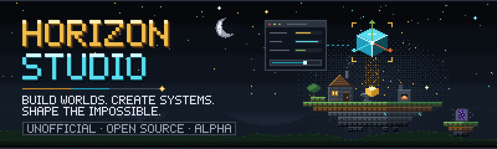
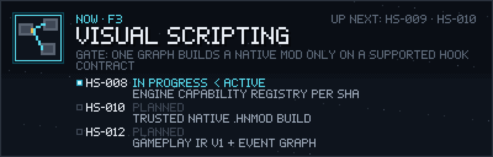
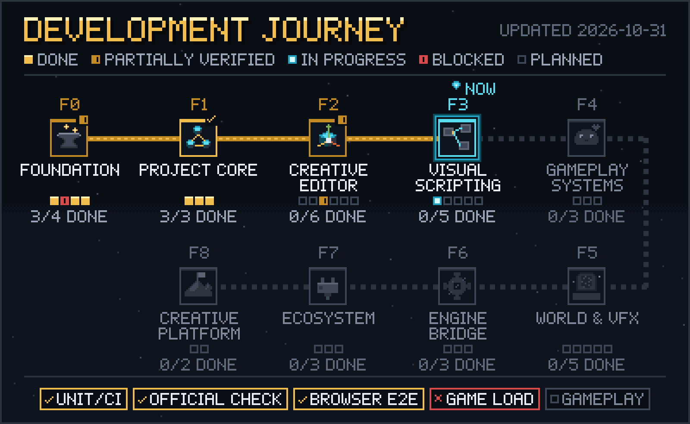
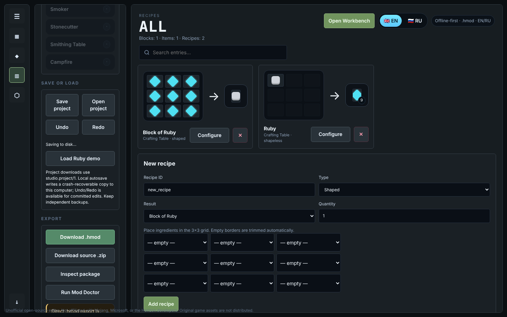
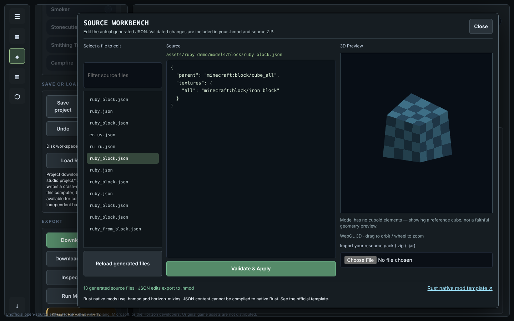

<p align="center">
  
</p>

<p align="center">
  <a href="README.ru.md">Русская версия</a> ·
  <a href="docs/ROADMAP_VISUAL.md">Roadmap</a> ·
  <a href="docs/COMPATIBILITY_EVIDENCE.md">Compatibility evidence</a> ·
  <a href="CHANGELOG.md">Changelog</a> ·
  <a href="CONTRIBUTING.md">Contributing</a>
</p>

<p align="center">
  
  
  
  
  
</p>

**Horizon Studio** is an open-source visual workshop for making content mods for [Horizon](https://github.com/horizon-rust/horizon), the Rust re-implementation of Minecraft Java Edition. You design blocks, items, crafting recipes and procedural structures in a local editor; Studio packages them as `.hmod` files that the **official Horizon checker accepts**. The long-term goal is one project that serves beginners (forms), creators (visual logic) and professionals (Rust), with every capability shown together with the evidence that it works.

> **Unofficial project.** Not affiliated with Mojang, Microsoft or the Horizon developers. No game binaries, account bypasses or game assets are included.

## Where we are now

<p align="center">
  
</p>

- **Released:** Version **0.6 — Source Workbench** (Windows EXE prerelease). `master` is ahead of that release with the canonical project format, disk workspaces and Undo/Redo, which have not been packaged yet.
- **Proven:** the example mods pass the official `cargo-horizon-mod check` built from a pinned Horizon revision, in CI and locally.
- **Proven in a browser:** 13 editor workflows run in Chromium on every pull request (Ubuntu CI), including autosave, recovery, revision conflicts and the exported package bytes.
- **Not yet proven:** loading a Studio mod in the running game, and any gameplay behaviour.

## Roadmap

<p align="center">
  
</p>

<!-- roadmap:status:start -->
| Phase | Focus | Status | Milestones done |
|---|---|---|---|
| F0 Foundation | Official validator, secure local API, release metadata, real-game smoke harness | Partially verified | 3 / 4 |
| F1 Project Core | Canonical project document, migrations, durable workspace, undo, browser E2E | **In progress** | 2 / 3 |
| F2 Creative Editor | Modular UI, docking, search, 3D selection, Blockbench interchange, Rust code bridge (HS-011) | Planned | 0 / 2 |
| F3 Visual Scripting | Capability registry, typed graph IR, .hmod and trusted native .hnmod backends (HS-010) | Planned | 0 / 3 |
| F4 Gameplay Systems | Entities, components, AI behaviour trees, events, RPG and automation | Planned | 0 / 1 |
| F5 World & VFX | Shader graph over .hshader, particles, physics sandbox, dimensions | Planned | 0 / 3 |
| F6 Engine Bridge | Upstream-accepted engine capabilities: entities, server events, worldgen, physics, rendering | Planned | — |
| F7 Ecosystem | Secure plugin SDK, templates, signed releases, publishing | Planned | 0 / 2 |
| F8 Creative Platform | Advanced animation, procedural worlds, team assets, eight end-to-end demos | Planned | — |

**Verification levels:** Unit/CI — verified → Official check — verified → Browser E2E — verified → Game load — blocked → Gameplay — planned
<!-- roadmap:status:end -->

Phase states are derived from milestone states in [`docs/roadmap/roadmap.json`](docs/roadmap/roadmap.json); every *done* or *partially verified* milestone links its evidence. Details, dependencies and evidence: **[docs/ROADMAP_VISUAL.md](docs/ROADMAP_VISUAL.md)**. Strategy: [Master Engineering Roadmap](docs/roadmap/master-2026-10-30.md).

## What works today

| Capability | State | Strongest evidence |
|---|---|---|
| Blocks and items from vanilla templates, custom PNG textures, EN/RU names | Works in Studio | Unit tests; official check of examples |
| Shaped and shapeless recipes, mining tool tags, loot tables | Works in Studio | Unit tests; official check of examples |
| Voxel Architect: six seeded structure generators, rotation and mirroring, NBT export | Works in Studio | Unit tests; official check of `voxel_showcase` |
| `.hmod` packaging, byte-identical on every OS | Works | Official `cargo-horizon-mod check` (pinned engine) |
| Canonical `studio.project/1` with stable IDs; migration of older projects | Works | Golden migration tests, byte-identical builds |
| Disk workspace with crash recovery, revision conflicts, Undo/Redo | Works in Studio | Python, Node and browser E2E tests |
| Source Workbench: validated JSON overrides, cuboid 3D preview | Works in Studio | Unit tests; browser E2E (override reaches the `.hmod`) |
| Mod Doctor static diagnostics, CLI (`build`, `verify`, `migrate`, `graph`…) | Works | Unit tests |
| Loading in the Horizon game | **Not verified** | Harness ready, needs an authorized installation |
| Visual scripting, entities/AI, native Rust mods, shaders | **Not implemented** | Planned in F2–F5 |

## Screenshots

Captured from the running editor (Playwright, 1440×900, built-in Ruby demo) — not mock-ups.

<p align="center">
  
  
</p>

## Quick start

**Windows (no Python needed):** download `HorizonStudio-<version>-Windows-x64.exe` from [Releases](https://github.com/pneqnp-iswr/horizon-studio/releases), optionally check it against `SHA256SUMS.txt`, and run it. The executable is portable and unsigned, so SmartScreen may warn. The latest release predates the features above that are marked as newer than 0.6.

**From source (Python 3.11+, standard library only):**

```sh
python3 studio.py            # or start_windows.bat / ./start_linux_macos.sh
# open http://127.0.0.1:8787 — the server listens on loopback only
```

**Command line:**

```sh
python horizon_cli.py build   examples/workshop_showcase.hstudio.json -o dist/workshop_showcase.hmod
python horizon_cli.py doctor  examples/workshop_showcase.hstudio.json
python horizon_cli.py migrate examples/ruby_demo.hstudio.json -o my_project.hstudio.json
python horizon_cli.py graph   examples/workshop_showcase.hstudio.json
python horizon_cli.py verify  examples/ruby_demo.hstudio.json --direct-validator --validator-bin /path/to/cargo-horizon-mod
```

Every command reads both `studio.project/1` and older `.hstudio.json` files — see [PROJECT_FORMAT.md](docs/PROJECT_FORMAT.md). Workspaces and recovery: [WORKSPACE_DURABILITY.md](docs/WORKSPACE_DURABILITY.md).

## Compatibility and verification

Each level is separate evidence; passing one never implies the next.

| Level | Meaning | Status |
|---|---|---|
| Unit / CI | Studio's own tests on Ubuntu and Windows, Python 3.11/3.12, Node 22 | Verified on every PR |
| Official static check | Real `cargo-horizon-mod check --json` from Horizon `d2186eb` accepts the exact package bytes | Verified for all examples ([ledger](docs/COMPATIBILITY_EVIDENCE.md)) |
| Browser end-to-end | Editor workflows driven in a real browser | Verified in CI: 13 scenarios, Chromium on Ubuntu ([scope](docs/BROWSER_E2E.md)) |
| Game content load | A real Horizon client loads the package | Not verified — [procedure](docs/GAME_CONTENT_SMOKE.md) |
| Gameplay | Behaviour asserted in a running game | Not verified |

## Development

```sh
python -m unittest discover -s tests -v          # Python suite (CI: Ubuntu + Windows)
node --test tests/test_editor_*.cjs             # editor history and workspace sync (CI: Node 22)
node --test tests/e2e/*.e2e.cjs                  # browser E2E, needs Playwright Chromium (docs/BROWSER_E2E.md)
python scripts/roadmap.py                        # re-render roadmap images and tables from roadmap.json
python scripts/render_branding.py                # re-render the pixel-art banner and mark
```

The banner, mark and roadmap are drawn pixel by pixel by these scripts (no external images or fonts); tests fail if a committed image is stale. Visual language: [DESIGN_SYSTEM.md](docs/branding/DESIGN_SYSTEM.md).

```text
studio.py            local editor server and API      studio_core/   project document, migration, graph, workspaces
index.html, *.js     browser editor (EN/RU)           horizon_compat/ official checker adapter
voxel_architect.py   structure generators             scripts/       CLI helpers, evidence, smoke, image renderers
mod_doctor.py        static diagnostics               tests/         Python and Node tests
```

Releases: the `VERSION` file is canonical; changing it on `master` builds, smoke-tests and publishes a Windows prerelease without overwriting existing tags.

## Contributing

Read [CONTRIBUTING.md](CONTRIBUTING.md), [CODE_OF_CONDUCT.md](CODE_OF_CONDUCT.md) and [SECURITY.md](SECURITY.md). Compatibility claims need evidence: update [`roadmap.json`](docs/roadmap/roadmap.json) together with the code and its tests.

## License

MIT. Horizon Studio is an independent, unofficial project; Minecraft is a trademark of Mojang Synergies AB, and Horizon belongs to its developers. See [LEGAL_AND_DISTRIBUTION.md](docs/roadmap/LEGAL_AND_DISTRIBUTION.md).
