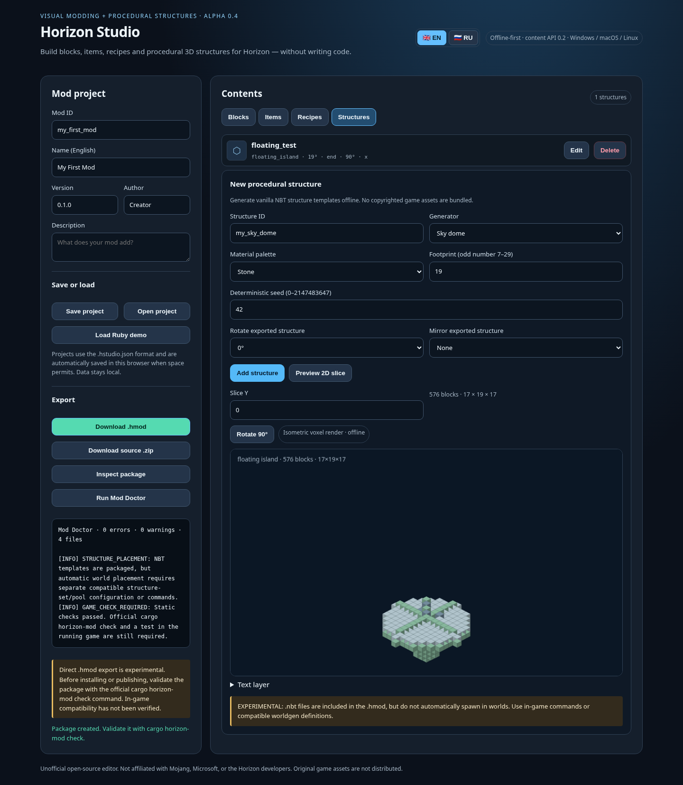

# Horizon Studio

**Visual mod authoring and reproducible content-mod builds for Horizon — offline and open source.**

[Русская документация](README.ru.md) · [Feature matrix](docs/FEATURE_MATRIX.md) · [Contributing](CONTRIBUTING.md) · [Changelog](CHANGELOG.md)

Horizon Studio creates editable `.hstudio.json` projects, experimental `.hmod` packages and source ZIPs. Version **0.4 (Mod Workshop)** includes a visual editor, a procedural structure engine, a static diagnostics tool and a CLI for automated workflows.

> **Alpha / not game-verified.** Python unit tests, a local HTTP integration test and Chromium UI smoke tests have passed. The project's `.hmod` files have **not** been validated with the official `cargo horizon-mod check` tool or loaded into an actual Horizon game. Horizon currently documents content mods for single-player use. Treat exported mods as experimental until tested against a matching game build.



## What's inside 0.4

- **Blocks and items:** editable vanilla templates, hardness, luminance, sounds, friction, rarity, stack size and optional PNG textures.
- **Mining gameplay:** pickaxe/axe/shovel/hoe tags and optional minimum stone/iron/diamond tool tiers. Generated tags are additive; all tags and block behavior still need game verification.
- **Bilingual game content:** English `en_us` and Russian `ru_ru` item/block names, with explicit English fallback.
- **Recipe creator:** shaped 3×3 and shapeless crafting with modded ingredients.
- **Voxel Architect:** 6 generators — sky dome, spiral tower, labyrinth, floating island, crystal grove and battle arena. Six vanilla block palettes, reproducible random seeds, 0°/90°/180°/270° model rotation and X/Z mirroring.
- **Viewer:** isometric block preview, independently rotatable camera, 2D layers and structure statistics.
- **NBT export:** gzip-compressed vanilla structure templates with tested palette and coordinate encoding. Packaged under `data/<modid>/structure/*.nbt`.
- **Mod Doctor:** identifies export errors, duplicate recipe shapes, and possible craft-only bootstrapping dead-ends; provides file/entry statistics. Its static checks are **not** an official game validation.
- **Offline CLI:** reproducible `.hmod`/ZIP builds, diagnostics and inspection for scripting and CI.
- **Languages:** English is the default UI; 🇬🇧 EN / 🇷🇺 RU switches the interface without losing current edits and saves the setting locally.

## Run the visual editor

Requires Python **3.11+**, no third-party Python packages.

- Windows: double-click `start_windows.bat`
- Linux/macOS: `./start_linux_macos.sh` or `python3 studio.py`

Open `http://127.0.0.1:8787`. The development server binds only to loopback and does not send files to a cloud service. Save projects regularly, particularly before updating the application or clearing browser storage.

## Developer CLI

```sh
python horizon_cli.py doctor examples/workshop_showcase.hstudio.json
python horizon_cli.py doctor examples/workshop_showcase.hstudio.json --json
python horizon_cli.py inspect examples/workshop_showcase.hstudio.json
python horizon_cli.py build examples/workshop_showcase.hstudio.json --output dist/workshop_showcase.hmod
python horizon_cli.py source examples/workshop_showcase.hstudio.json --output dist/workshop_showcase-source.zip
```

`doctor` returns exit code 1 for an export error, 0 for a successful local check. Warnings alone do not fail the build. `build` packs content-only mods, not Rust native mods. For the official format validator:

```sh
cargo install --git https://github.com/horizon-rust/horizon cargo-horizon-mod
cargo horizon-mod check dist/workshop_showcase.hmod
```

For development, the official documentation also describes the `--dev-mod` launcher argument and `cargo horizon-mod run` workflows. See [content mods](https://playhorizon.dev/docs/content-mods) for the current instructions.

## Tests

```sh
python -m unittest discover -s tests -v
```

The suite covers NBT decoding, geometry transforms, deterministic output, mineable tags, languages, recipes, static diagnostics, HTTP endpoints and packaging. GitHub Actions tests Python 3.11/3.12 on Windows and Linux. A local Chromium smoke test was also run; its mocked API responses are not a substitute for game integration.

## Boundaries

- Structure NBT files do **not** cause automatic world generation. Placing structures needs compatible worldgen data or in-game commands.
- The content-mod API cannot implement new arbitrary gameplay behavior without Horizon's native mod/server interfaces or modifications to the engine.
- This project makes **no claim** that Java cannot implement the same algorithms. `Rust engine integration` describes a requirement of the **Horizon architecture**, not a Java impossibility.
- No game binaries, assets, or authentication bypass are included.

See [the feature matrix](docs/FEATURE_MATRIX.md) for implemented, experimental and proposed functionality.

## Examples and source layout

- `examples/workshop_showcase.hstudio.json`: six generators, bilingual names, tool tags and crafting recipes.
- `examples/workshop_showcase.hmod`: locally generated sample content package (not officially verified).
- `studio.py`: local editor HTTP API and content packager.
- `voxel_architect.py`: deterministic voxel geometry and NBT encoding.
- `mod_doctor.py`: static project diagnostics.
- `horizon_cli.py`: scripting/CI interface.
- `index.html` + `i18n.js`: visual editor and translations.
- `tests/`: offline regression suite.

## Licensing and security

MIT-licensed. Unofficial independent project, not endorsed by Horizon, Mojang or Microsoft. No proprietary game assets are bundled. Review [Security](SECURITY.md) and [Contributing](CONTRIBUTING.md) before submitting changes.
