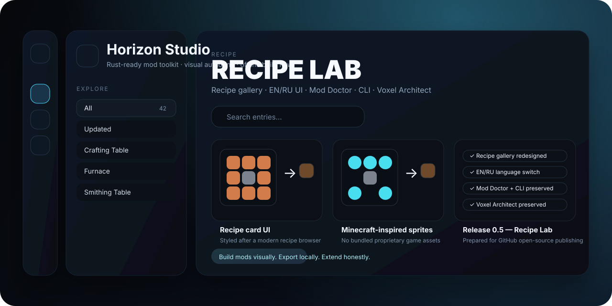

<p align="center">
  
</p>

<h1 align="center">Horizon Studio</h1>
<p align="center"><strong>Visual mod authoring toolkit for Horizon</strong><br/>Offline-first editor, experimental <code>.hmod</code> packaging, procedural structures, diagnostics, and a developer CLI.</p>

<p align="center">
  <a href="README.ru.md">Русская версия</a> ·
  <a href="CHANGELOG.md">Changelog</a> ·
  <a href="CONTRIBUTING.md">Contributing</a> ·
  <a href="SECURITY.md">Security</a>
</p>

<p align="center">
  
  
  
  
  
</p>

> **Important:** Horizon Studio is an **unofficial** open-source tool. It is **not affiliated** with Mojang, Microsoft, or the Horizon developers. No proprietary game binaries, authentication bypasses, or bundled game assets are included.

## What is Horizon Studio?

Horizon Studio is a local toolchain for creating and packaging content-style Horizon mods without forcing the user to write Rust or manually build JSON/NBT archives by hand.

Version **0.6 — Source Workbench** adds bounded JSON source editing, a local 3D model preview and resource-pack import on top of the Recipe Lab workflow.

### Core goals

- **Visual authoring** for blocks, items, recipes, and procedural structures.
- **Offline-first workflow** with no cloud requirement.
- **Developer tooling** for repeatable builds and validation.
- **EN default / RU optional** localization for the editor and exported names.
- **Honest scope**: content workflows now, deeper engine/native integration later.

---

## Highlights in 0.6 — Source Workbench and Recipe Lab

### New source editing and preview
- Source Workbench: validated JSON overrides included in `.hmod` exports.
- WebGL cuboid model preview and fallback rendering.
- Selective import from user-owned local resource pack ZIP/JAR archives; no proprietary assets bundled.

### Recipe Lab UI direction
- Large **recipe gallery** presentation inspired by your target design language.
- New **left rail + explorer + workspace** layout.
- Better project presentation for GitHub/open-source publishing.
- English UI by default, Russian switch preserved.

### Preserved functionality from earlier releases
- Custom **blocks** and **items** with vanilla templates.
- **Shaped** and **shapeless** crafting recipes.
- Optional custom **PNG textures**.
- **Bilingual names** for `en_us` and `ru_ru`.
- **Mining tool** and **minimum tier** tag generation.
- **Voxel Architect** with six deterministic structure generators:
  - Sky Dome
  - Spiral Tower
  - Seeded Labyrinth
  - Floating Island
  - Crystal Grove
  - Battle Arena
- Structure export transforms:
  - rotation `0° / 90° / 180° / 270°`
  - mirroring on `X / Z`
- **Mod Doctor** static diagnostics.
- **CLI** for inspection, validation and build automation.

---

## Current capability map

| Area | Status |
|---|---|
| Visual editor | Implemented |
| Recipe authoring | Implemented |
| Block/item authoring | Implemented |
| Procedural structure generation | Implemented |
| Local `.hmod` packaging | Implemented (experimental) |
| Static diagnostics | Implemented |
| CLI automation | Implemented |
| In-game verification | Not yet confirmed |
| Official `cargo horizon-mod check` verification | Not yet run in this repo |
| Native engine/server behavior editing | Not implemented yet |

---

## Quick start

Requires **Python 3.11+**.

### Run the editor

**Windows**
```bat
start_windows.bat
```

**Linux / macOS**
```sh
./start_linux_macos.sh
# or
python3 studio.py
```

Then open:
```text
http://127.0.0.1:8787
```

The local server binds only to loopback.

---

## CLI

```sh
python horizon_cli.py doctor examples/workshop_showcase.hstudio.json
python horizon_cli.py doctor examples/workshop_showcase.hstudio.json --json
python horizon_cli.py inspect examples/workshop_showcase.hstudio.json
python horizon_cli.py build examples/workshop_showcase.hstudio.json --output dist/workshop_showcase.hmod
python horizon_cli.py source examples/workshop_showcase.hstudio.json --output dist/workshop_showcase-source.zip
```

### Intended use cases
- CI validation
- scripted build/export pipelines
- regression testing for sample projects
- quick packaging without opening the browser UI

---

## Testing

```sh
python -m unittest discover -s tests -v
```

CI runs the full test suite across Python 3.11/3.12 on Windows and Ubuntu. See the live status badge rather than relying on an outdated hard-coded test count.

Coverage includes:
- packaging
- recipes
- languages
- mining tags
- structure generation
- geometry transforms
- doctor checks
- HTTP endpoints
- CLI behavior

---

## Project layout

```text
index.html           Frontend UI
studio.py            Local editor server + export API
i18n.js              EN/RU localization
voxel_architect.py   Deterministic procedural structure engine
mod_doctor.py        Static diagnostics
horizon_cli.py       Headless build / inspect / doctor CLI
examples/            Demo projects and generated examples
tests/               Regression suite
```

---

## Examples

- `examples/ruby_demo.hstudio.json` — minimal starter sample
- `examples/voxel_showcase.hstudio.json` — structure showcase
- `examples/workshop_showcase.hstudio.json` — broad sample using multiple features
- `.hmod` files are built locally and remain unverified in the running Horizon game

---

## Boundaries and honesty

Horizon Studio is meant to stay technically honest.

### What it does **not** claim
- It does **not** claim that Java can never implement similar tooling.
- It does **not** claim official compatibility until real in-game validation is done.
- It does **not** bundle default Minecraft/Horizon assets.
- It does **not** provide new arbitrary gameplay behavior through content-only packaging alone.

### What likely requires deeper Rust / engine work later
- native hooks
- live server-side behavior systems
- gameplay scripting runtime
- event graph execution inside Horizon
- “MCreator-like” high-level gameplay logic authoring beyond content packs

---

## Contributing

This project is intended to grow into a serious open-source toolkit.

If you contribute, please read:
- [CONTRIBUTING.md](CONTRIBUTING.md)
- [CODE_OF_CONDUCT.md](CODE_OF_CONDUCT.md)
- [SECURITY.md](SECURITY.md)

---

## License

MIT License.

---

## Roadmap ideas

- richer recipe workstation support
- visual icon/texture browser
- better asset import pipeline
- node/event logic editor for future native extensions
- schema/version migration helpers
- polished GitHub Releases packaging
- screenshots and official branding assets for the repository

Development continues against the versioned [Master Engineering Roadmap](docs/roadmap/master-2026-10-30.md) and [Implementation Status](docs/roadmap/IMPLEMENTATION_STATUS.md).

## Windows downloads — GitHub Releases

**No Python installation required for Windows users.** Each release has a standalone x64 executable, for example:

[**Browse versioned Windows `.exe` downloads**](https://github.com/pneqnp-iswr/horizon-studio/releases)

1. Open the relevant GitHub release (for example `v0.6.0`).
2. Download `HorizonStudio-<version>-Windows-x64.exe` from **Assets**.
3. Optionally check its SHA-256 using the release's `SHA256SUMS.txt`.
4. Double-click to start, use **Open Studio**, then **Stop & Exit** to shut down.

The application serves the editor locally at `http://127.0.0.1:8787`; keeping that port stable preserves browser-local projects and language settings. A second copy cannot use the same port at the same time. The app is **portable, not an installer**, and currently unsigned: Windows may show SmartScreen warnings.

### Release engineering

The `VERSION` file is the canonical release version. On `master`, changing `VERSION` triggers a Windows GitHub Actions job that runs tests, builds with PyInstaller, smoke-tests the **actual compiled `.exe`**, calculates SHA-256, and publishes an immutable-by-convention GitHub **prerelease**. Existing versions are not overwritten. You can also run it manually using **Actions → Windows EXE / versioned Release → Run workflow**.

For a new release, update `VERSION`, `RELEASE_NOTES.md`, `CHANGELOG.md` and the displayed version in the README before pushing. Do not bump only the README badge.

## Engineering roadmap and legal policy (2026-10-30)

The [full Master Engineering Roadmap](docs/roadmap/master-2026-10-30.md) describes the verified source audit, capability registry, phased IDE/asset/visual programming development, AI/VFX plans, release gates, prioritized backlog and first three concrete iterations. [Research index and PDF](docs/roadmap/README.md) · [Legal policy](docs/roadmap/LEGAL_AND_DISTRIBUTION.md).

Current implementation focus: **Studio only**. The separate companion fork is not modified. In-game compatibility must still be proven with official validator and runtime tests.
