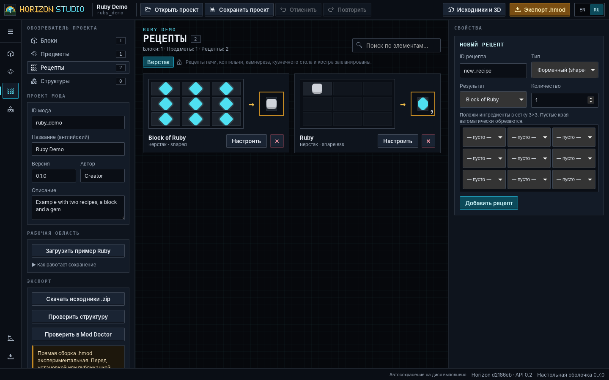
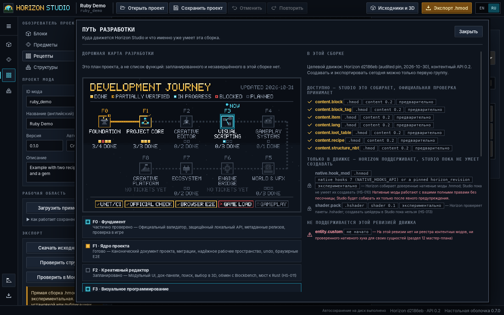
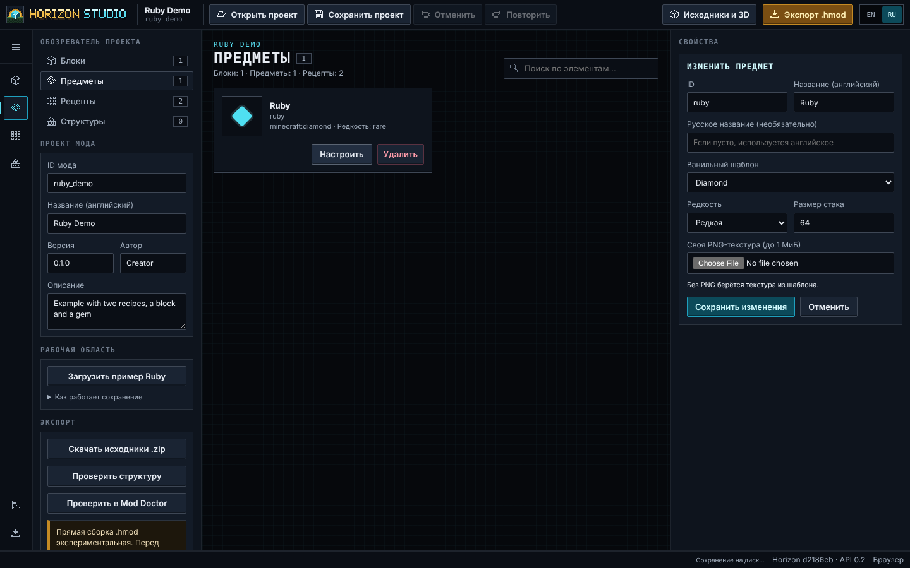
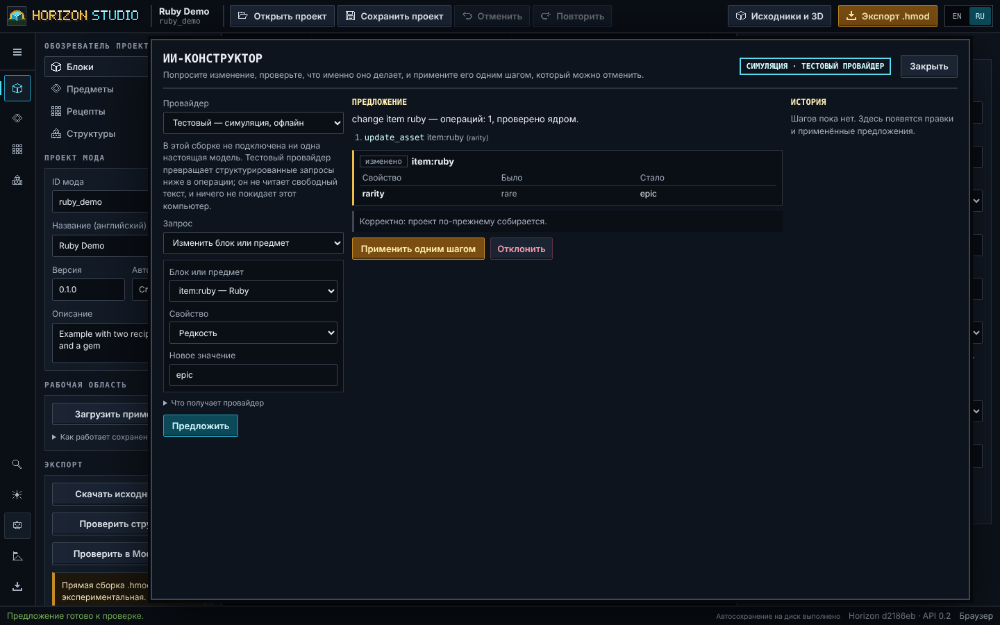
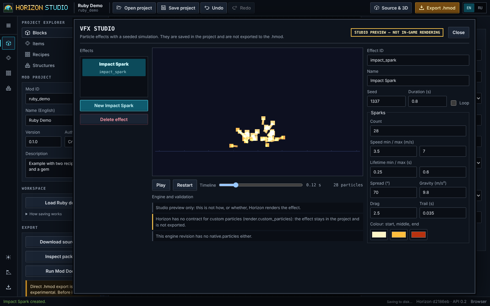

<p align="center">
  
</p>

<p align="center">
  <a href="README.md">English</a> ·
  <a href="docs/ROADMAP_VISUAL.md">Дорожная карта</a> ·
  <a href="docs/COMPATIBILITY_EVIDENCE.md">Доказательства совместимости</a> ·
  <a href="CHANGELOG.md">Изменения</a> ·
  <a href="CONTRIBUTING.md">Участие</a>
</p>

<p align="center">
  
  
  
  
  
</p>

**Horizon Studio** — открытая визуальная мастерская для создания контентных модов для [Horizon](https://github.com/horizon-rust/horizon), реализации Minecraft Java Edition на Rust. Блоки, предметы, рецепты и процедурные структуры создаются в локальном редакторе; Studio упаковывает их в файлы `.hmod`, которые **принимает официальная проверка Horizon**. Долгосрочная цель — один проект для новичков (формы), авторов (визуальная логика) и профессионалов (Rust), где каждая возможность показана вместе с доказательством того, что она работает.

> **Неофициальный проект.** Не связан с Mojang, Microsoft или разработчиками Horizon. Игровые бинарники, обход авторизации и игровые ресурсы не включены.

## Последний релиз для Windows

<!-- roadmap:release:start -->
**[Horizon Studio v0.7.0 — Project Core](https://github.com/pneqnp-iswr/horizon-studio/releases/tag/v0.7.0)** · альфа-предрелиз · опубликован 2026-10-30  
⬇ **[HorizonStudio-0.7.0-Windows-x64.exe](https://github.com/pneqnp-iswr/horizon-studio/releases/download/v0.7.0/HorizonStudio-0.7.0-Windows-x64.exe)** · 11,6 МБ · [SHA256SUMS.txt](https://github.com/pneqnp-iswr/horizon-studio/releases/download/v0.7.0/SHA256SUMS.txt)  
SHA-256 `3f96e67154a09a6b292a3227c26369f9024d33d6158033d9a325c23b06fcf4b9` · собран из [`c816211`](https://github.com/pneqnp-iswr/horizon-studio/commit/c816211b01670d06411ef5a4acd336b8658cdd6a) · без подписи

**В этой сборке** (гейты релиза на теговом коммите (Python, Node, браузерные E2E, официальный checker), двойной самотест EXE и GUI-запуск на Windows; прогон 41136925994, проверено через GitHub API 2026-10-31):

- Канонический studio.project/1 со стабильными ID; старые проекты открываются и мигрируют
- Рабочее пространство на диске: восстановление, выбор при конфликте ревизий, Undo/Redo
- Модульный редактор с выдвижной панелью и раскладкой для узких экранов
- Защищённый локальный API (токен сессии, проверки Host/Origin)
- Экспорт .hmod совпадает с официально проверенными пакетами, в том числе из этой Windows-сборки
- Блоки, предметы, рецепты, текстуры, структуры, Source Workbench и Mod Doctor из 0.6
<!-- roadmap:release:end -->

Правила и проверка релизов: [docs/RELEASING.md](docs/RELEASING.md). У каждого релиза есть `SHA256SUMS.txt`; начиная с 0.7.0 — ещё и `build-manifest.json`.

## Где мы сейчас

<p align="center">
  
</p>

- **В разработке:** Версия **0.8 — Настольная студия** (`VERSION` в `master`). Панель выше показывает новейший релиз, чей EXE проверен через GitHub API; версия считается выпущенной только после этого.
- **Доказано:** примеры модов проходят официальный `cargo-horizon-mod check`, собранный из закреплённой ревизии Horizon, — в CI и локально.
- **Доказано в браузере:** сценарии редактора, рабочей области и дорожной карты выполняются в Chromium на каждом pull request (Ubuntu CI), включая автосохранение, восстановление, конфликты ревизий, байты экспортируемого пакета и аудит доступности ([текущий список](docs/BROWSER_E2E.md#current-inventory)).
- **Ещё не доказано:** загрузка мода Studio в запущенной игре и любое игровое поведение.

## Дорожная карта

<p align="center">
  
</p>

<!-- roadmap:status:start -->
| Фаза | Содержание | Статус | Готово тикетов |
|---|---|---|---|
| F0 Фундамент | Официальный валидатор, защищённый локальный API, метаданные релизов, проверка в игре | Частично проверено | 3 / 4 |
| F1 Ядро проекта | Канонический документ проекта, миграции, надёжное рабочее пространство, undo, браузерные E2E | Готово | 3 / 3 |
| F2 Креативный редактор | Модульный UI, док-панели, поиск, выбор в 3D, обмен с Blockbench, мост к Rust (HS-011) | Частично проверено | 0 / 6 |
| F3 Визуальное программирование | Реестр возможностей движка, типизированный IR графов, бэкенды .hmod и нативный .hnmod (HS-010) | **В работе** | 2 / 5 |
| F4 Игровые системы | Сущности, компоненты, деревья поведения ИИ, события, RPG и автоматизация | Запланировано | 0 / 3 |
| F5 Мир и эффекты | Шейдерный граф поверх .hshader, частицы, физическая песочница, измерения | Частично проверено | 1 / 5 |
| F6 Мост к движку | Принятые в upstream возможности движка: сущности, серверные события, мир, физика, рендер | Частично проверено | 0 / 3 |
| F7 Экосистема | Безопасный SDK плагинов, шаблоны, подписанные релизы, публикация | Запланировано | 0 / 3 |
| F8 Креативная платформа | Продвинутая анимация, процедурные миры, командные ассеты, восемь сквозных демо | Запланировано | 0 / 2 |

**Уровни проверки:** Модульные тесты и CI — подтверждено → Официальная проверка — подтверждено → Браузерные E2E — подтверждено → Загрузка в игре — заблокировано → Геймплей — запланировано
<!-- roadmap:status:end -->

Статус фазы вычисляется из статусов тикетов в [`docs/roadmap/roadmap.json`](docs/roadmap/roadmap.json); у каждого готового или частично проверенного тикета есть ссылки на доказательства. Подробности, зависимости и доказательства — **[docs/ROADMAP_VISUAL.md](docs/ROADMAP_VISUAL.md)** (на английском). Стратегия: [Master Engineering Roadmap](docs/roadmap/master-2026-10-30.md).

## Что работает сегодня

| Возможность | Состояние | Сильнейшее доказательство |
|---|---|---|
| Блоки и предметы на ванильных шаблонах, свои PNG-текстуры, имена EN/RU | Работает в Studio | Модульные тесты; официальная проверка примеров |
| Рецепты с формой и без, теги инструментов добычи, таблицы лута | Работает в Studio | Модульные тесты; официальная проверка примеров |
| Voxel Architect: шесть генераторов структур с seed, поворот и отражение, экспорт NBT | Работает в Studio | Модульные тесты; официальная проверка `voxel_showcase` |
| Упаковка `.hmod`, побайтово одинаковая на любой ОС | Работает | Официальный `cargo-horizon-mod check` (закреплённый движок) |
| Канонический `studio.project/1` со стабильными ID; миграция старых проектов | Работает | Golden-тесты миграции, побайтово одинаковые сборки |
| Рабочее пространство на диске с восстановлением, конфликтами ревизий, Undo/Redo | Работает в Studio | Тесты Python, Node и браузерные E2E |
| Общая история ваших правок и правок ИИ (HS-020): отмена и повтор переживают перезапуск, другая вкладка не перезапишет молча | Работает в Studio | Интеграционный тест из 13 шагов на реальной папке; браузерные и настольные E2E |
| AI Creator: запрос, построчный diff, применение одним шагом с отменой, отклонение, прерывание | Работает с **симулированным** тестовым провайдером; провайдер Claude есть, но **с настоящим API не проверялся** | Браузерные E2E; тесты провайдера с заменой клиента |
| Студия VFX: эффекты из нескольких эмиттеров, ключевые кривые, бюджеты, таймлайн | Работает в Studio (только предпросмотр, **не экспортируется**) | Python и редактор совпадают до 1e-12; браузерные E2E |
| Source Workbench: проверенные JSON-правки, 3D-превью кубоидов | Работает в Studio | Модульные тесты; браузерные E2E (правка попадает в `.hmod`) |
| Статическая диагностика Mod Doctor, CLI (`build`, `verify`, `migrate`, `graph`…) | Работает | Модульные тесты |
| Настольное окно: оболочка Tauri 2, установщик и портативная сборка для Windows, нативное «Сохранить как» | **Превью** (собирается в CI, не релиз) | Windows CI: установка, smoke-запуск, удаление ([DESKTOP.md](docs/DESKTOP.md)) |
| Рабочая область: обозреватель, холст, свойства, строка состояния, пиксельные иконки; путь разработки внутри приложения | Работает в Studio | Браузерные E2E, включая русский интерфейс без английских остатков |
| Проверка возможностей движка (HS-008): экспорт останавливается с объяснением, если цель не загрузит проект | Работает в Studio | Модульные тесты; браузерные E2E |
| Загрузка в игре Horizon | **Не проверено** | Сценарий готов, нужна легальная установка игры |
| Визуальное программирование, сущности/ИИ, нативные моды на Rust, шейдеры | **Не реализовано** | Запланировано в F2–F5 |

## Скриншоты

Сняты с работающего приложения, это не макеты: настольная оболочка с замороженным ядром (Linux WebKitGTK, управление
как у пользователя) и тот же редактор в Chromium. Другие размеры окна — в [docs/screenshots/desktop](docs/screenshots/desktop).

<p align="center">
  
</p>
<p align="center">
  
  
</p>
<p align="center">
  
  
</p>

## Быстрый старт

**Windows (Python не нужен):** скачайте `HorizonStudio-<version>-Windows-x64.exe` со страницы [Releases](https://github.com/pneqnp-iswr/horizon-studio/releases), при желании сверьте с `SHA256SUMS.txt` и запустите. Файл портативный и не подписан, поэтому SmartScreen может предупредить. Последний релиз старше возможностей, отмеченных выше как более новые, чем 0.6.

**Настольное превью (Windows):** каждое изменение собирает установщик и портативную папку в
[workflow Desktop shell](https://github.com/pneqnp-iswr/horizon-studio/actions/workflows/desktop.yml) (артефакт
`desktop-windows-preview-build`). Это превью, без подписи и не релиз — см. [DESKTOP.md](docs/DESKTOP.md).

**Из исходников (Python 3.11+, только стандартная библиотека):**

```sh
python3 studio.py            # или start_windows.bat / ./start_linux_macos.sh
# откройте http://127.0.0.1:8787 — сервер слушает только loopback
```

**Командная строка:**

```sh
python horizon_cli.py build   examples/workshop_showcase.hstudio.json -o dist/workshop_showcase.hmod
python horizon_cli.py doctor  examples/workshop_showcase.hstudio.json
python horizon_cli.py migrate examples/ruby_demo.hstudio.json -o my_project.hstudio.json
python horizon_cli.py graph   examples/workshop_showcase.hstudio.json
python horizon_cli.py verify  examples/ruby_demo.hstudio.json --direct-validator --validator-bin /path/to/cargo-horizon-mod
```

Все команды читают и `studio.project/1`, и старые файлы `.hstudio.json` — см. [PROJECT_FORMAT.md](docs/PROJECT_FORMAT.md). Рабочие пространства и восстановление: [WORKSPACE_DURABILITY.md](docs/WORKSPACE_DURABILITY.md).

## Совместимость и проверка

Каждый уровень — отдельное доказательство; прохождение одного не означает прохождения следующего.

| Уровень | Что означает | Статус |
|---|---|---|
| Модульные тесты / CI | Тесты Studio на Ubuntu и Windows, Python 3.11/3.12, Node 22 | Подтверждено в каждом PR |
| Официальная статическая проверка | Настоящий `cargo-horizon-mod check --json` из Horizon `d2186eb` принимает точные байты пакета | Подтверждено для всех примеров ([журнал](docs/COMPATIBILITY_EVIDENCE.md)) |
| Браузерные сквозные тесты | Сценарии редактора в настоящем браузере | Подтверждено в CI при каждом изменении, Chromium на Ubuntu ([текущий список](docs/BROWSER_E2E.md#current-inventory)) |
| Загрузка контента в игре | Настоящий клиент Horizon загружает пакет | Не проверено — [процедура](docs/GAME_CONTENT_SMOKE.md) |
| Геймплей | Поведение проверено в запущенной игре | Не проверено |

## Разработка

```sh
python -m unittest discover -s tests -v          # Python-тесты (CI: Ubuntu + Windows)
node --test tests/test_editor_*.cjs             # история и синхронизация с диском (CI: Node 22)
node --test tests/e2e/*.e2e.cjs                  # браузерные E2E, нужен Playwright Chromium (docs/BROWSER_E2E.md)
python scripts/roadmap.py                        # перерисовать роадмап и таблицы из roadmap.json
python scripts/render_branding.py                # перерисовать пиксельный баннер и знак
```

Баннер, знак и роадмап рисуются попиксельно этими скриптами (без внешних изображений и шрифтов); тесты падают, если закоммиченная картинка устарела. Визуальный язык: [DESIGN_SYSTEM.md](docs/branding/DESIGN_SYSTEM.md).

Релизы: канонична версия в файле `VERSION`; её изменение в `master` собирает, проверяет и публикует предрелиз Windows, не перезаписывая существующие теги.

## Участие

Прочитайте [CONTRIBUTING.md](CONTRIBUTING.md), [CODE_OF_CONDUCT.md](CODE_OF_CONDUCT.md) и [SECURITY.md](SECURITY.md). Заявления о совместимости требуют доказательств: обновляйте [`roadmap.json`](docs/roadmap/roadmap.json) вместе с кодом и тестами.

## Лицензия

MIT. Horizon Studio — независимый неофициальный проект; Minecraft — товарный знак Mojang Synergies AB, Horizon принадлежит своим разработчикам. См. [LEGAL_AND_DISTRIBUTION.md](docs/roadmap/LEGAL_AND_DISTRIBUTION.md).
