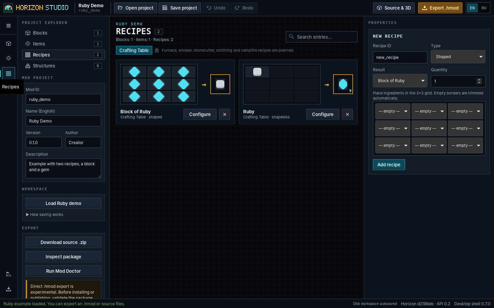

# Horizon Studio desktop application (preview)

Horizon Studio runs as **one native window**: a Tauri 2 shell (`desktop/`) hosts the same editor the browser build
uses, served by the bundled project core on a private loopback port. Why this design, the alternatives and the
measurements: [ADR 0002](adr/0002-desktop-shell.md).

> **Status: preview.** CI builds a Windows installer and a portable folder for every change (`desktop.yml`, artifacts
> kept 14 days). They are not published releases. The verified release stays the 0.7 single EXE until the gates in
> ADR 0002 are met. The installer and executables are **unsigned**.

<p align="center">
  
</p>

## Using it

- **Windows installer:** `HorizonStudio-Desktop-<version>-preview-<sha>-Windows-x64-setup.exe` installs per user (no
  administrator rights) into `%LOCALAPPDATA%\Horizon Studio`, in English or Russian, and adds an uninstaller.
- **Portable:** unzip `HorizonStudio-Desktop-…-Windows-x64.zip` and run `HorizonStudio.exe`; keep the `core` folder
  next to it.
- Projects open with **Open project** and save with **Save project** through native file dialogs. Exports
  (`.hmod`, source ZIP) use the native *Save as* dialog; cancelling writes nothing.
- Autosaved workspaces are shared with the browser build and 0.7: `~/.horizon-studio/workspaces`.
- WebView2 is required (part of current Windows 10 and 11).

## How it is put together

| Part | File | Role |
|---|---|---|
| Shell | `desktop/src/main.rs` | window, navigation guard, IPC commands, smoke report |
| Core process | `desktop/src/core.rs` | finds and starts the core, checks its handshake, stops it |
| Options | `desktop/src/options.rs` | `--smoke-report`, `--smoke-hold`, `--smoke-timeout`, `--window-size` |
| Splash | `desktop/splash/` | bundled loading screen; shows the core's error and log path if it cannot start |
| Core | `launcher.py --serve` | protocol `horizon-studio.core/1`: one JSON line with the URL, then serves until stdin closes |
| Bridge | `desktop_bridge.js` | in the editor: native *Save as*, the ready signal; inactive in a browser |
| Icons | `desktop/icons/` | generated from the pixel mark by `scripts/make_desktop_icons.py` |

### Security

- The window shows only the bundled splash and the core's exact origin (`http://127.0.0.1:<port>`); every other
  navigation is refused. `https` links open in the system browser.
- The editor can call two commands, `desktop_ready` and `save_file`. They are declared in an app manifest
  (`desktop/build.rs`), so the ACL applies, and granted at runtime to the core's origin and the `main` window only.
  The splash page has none.
- `save_file` accepts a bare file name (no paths or reserved characters), at most 256 MiB, shows a native dialog and
  writes atomically (temporary file, then rename).
- The core keeps its own protections: random port, session token, Host and Origin checks, loopback only.
- No arbitrary code runs in the shell or the core. Native `.hnmod` authoring is not part of this build (HS-010).

### Lifecycle

The shell starts the core with piped stdin and stdout and waits up to 60 s for the handshake. Closing the window
closes the core's stdin; the core shuts its server down and exits with 0. If the shell crashes or is killed, the
operating system closes the pipe and the core exits the same way. The core's stderr goes to `core.log` in the
application's log directory (`%LOCALAPPDATA%\io.github.pneqnp-iswr.horizonstudio\logs` on Windows).

## Building

Prerequisites: Rust 1.90+, Python 3.11+, Node 22 (only for the Tauri CLI), and on Linux WebKitGTK 4.1
(`libwebkit2gtk-4.1-dev libgtk-3-dev libsoup-3.0-dev librsvg2-dev`).

```sh
# development: the shell starts `python launcher.py --serve` from the repository
cd desktop && cargo run

# release: freeze the core, then build the shell and installer with the core bundled as core/
python -m pip install pyinstaller==6.16.0
python scripts/build_desktop.py
cd desktop && npx --yes @tauri-apps/cli@2.12.4 build --bundles nsis --config tauri.release.conf.json
```

Release builds never fall back to a Python interpreter found on the system; only debug builds do.

## Tests and evidence

| What | Where |
|---|---|
| Shell unit tests (handshake, navigation guard, file names, atomic and concurrent writes, interruption, core lifecycle) | `cd desktop && cargo test` on Linux and Windows |
| Core protocol and lifecycle | `tests/test_launcher.py` |
| Shell contracts without Rust (versions, commands vs ACL, CSP, icons, splash) | `tests/test_desktop.py` |
| Bridge | `tests/test_desktop_bridge.cjs` |
| Smoke: real application runs | `scripts/desktop_probe.py` in `desktop.yml`: Linux (Xvfb) and Windows (portable cold and warm, 960×600 to 1920×1080; installed) |
| Functional E2E on the real window | `tests/desktop/desktop.e2e.cjs` through tauri-driver, Linux and Windows ([below](#desktop-e2e)) |

`desktop_probe.py` starts the real executable with `--smoke-report`, waits for the editor's ready signal, records the
process tree's memory and a screenshot, then waits for the shell to exit on its own; the report includes the core's
exit code.

Screenshots of the running desktop application (release shell with the frozen core, Linux WebKitGTK, captured by
driving the real window with `xdotool`): [`screenshots/desktop/`](screenshots/desktop/). Windows screenshots are in
each `desktop.yml` run's `desktop-windows-evidence` artifact.

## Desktop E2E

Smoke runs prove that the packaged application starts, shows the editor and stops its core. The functional suite goes
further: it drives the real shell window, its WebView and its core through [tauri-driver](https://v2.tauri.app/develop/tests/webdriver/)
(WebKitWebDriver on Linux, msedgedriver matching the installed WebView2 on Windows), with a scratch home folder per
scenario. It is not the browser suite: nothing here talks to a separately started localhost server.

It needs a test build of the shell with the cargo feature `e2e`, which answers the native Save dialog from
`HORIZON_STUDIO_E2E_SAVE_DIR` (or cancels it with `HORIZON_STUDIO_E2E_CANCEL_SAVE`) and lets a scenario point the shell
at a missing core (`HORIZON_STUDIO_E2E_CORE`). Packaged builds never have it: the smoke report records `test_build`, and
`desktop_probe.py` fails a test build unless told otherwise; `tests/test_desktop.py` checks that no packaging step enables
the feature.

```sh
cd desktop && cargo build --features e2e && cd ..
cargo install tauri-driver --locked --version 2.1.0     # plus webkit2gtk-driver on Linux, msedgedriver on Windows
DESKTOP_APP=desktop/target/debug/horizon-studio xvfb-run -a node --test tests/desktop/desktop.e2e.cjs
```

<!-- roadmap:desktop-e2e-inventory:start -->
**7 scenarios** on the current master (generated by `scripts/test_inventory.py`):

| File | Scenario |
|---|---|
| `desktop.e2e.cjs` | launches the real window, completes the core handshake and loads the editor |
| `desktop.e2e.cjs` | creates a block, an item and a recipe, renames with stable uids, undoes and redoes |
| `desktop.e2e.cjs` | saves through the native save path, reopens the project and exports the officially checked .hmod |
| `desktop.e2e.cjs` | a cancelled save dialog writes nothing |
| `desktop.e2e.cjs` | switches EN/RU, explores the development journey and refuses an export the engine cannot load |
| `desktop.e2e.cjs` | a restarted window recovers the disk workspace |
| `desktop.e2e.cjs` | a core that cannot start shows the failure screen instead of a blank window |
<!-- roadmap:desktop-e2e-inventory:end -->
