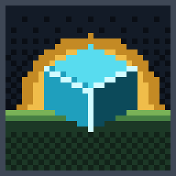

# Horizon Studio — Visual Design System

Horizon Studio's identity is a **night-time voxel workshop**: warm forge light (gold) for things that are made and proven, cool tool light (cyan) for the editor and work in progress, on graphite and moss. Every image is original and is drawn by code, so it can be regenerated, reviewed in a diff and kept consistent.

## Assets

| File | Logical size × scale | Generator |
|---|---|---|
| `assets/branding/horizon-studio-banner.svg` (+ `.png`) | 400 × 120 × 4 → 1600 × 480 | `scripts/render_branding.py` |
| `assets/branding/horizon-studio-mark.svg` (+ `.png`) | 32 × 32 × 8 → 256 × 256 | `scripts/render_branding.py` |
| `assets/roadmap/roadmap-overview.svg` | 400 × 246 × 4 | `scripts/roadmap.py` |
| `assets/roadmap/current-phase.svg` | 400 × content height × 4 | `scripts/roadmap.py` |

`python scripts/render_branding.py --check` and `python scripts/roadmap.py --check` (both run by the test suite) fail when a committed image differs from a fresh render.

## Pixel grid

- One **logical pixel** is the smallest unit. Images are authored on the logical grid and scaled by a whole number only (4× for banner and roadmap, 8× for the mark).
- SVGs set `shape-rendering="crispEdges"` and a `viewBox` in logical pixels, so edges stay sharp at any display width. PNGs use nearest-neighbour scaling.
- Never mix pixel sizes in one image: text, icons and scenery share the same grid. Text may be scaled 2× or 3× for titles, never by fractions.
- Gradients are **ordered-dither bands** (4 × 4 Bayer pattern), never smooth vector gradients.
- Light comes from the **upper left**: lit faces and top edges use the lighter tone, right and bottom edges the darker one.

## Palette

Defined once in `scripts/pixelart.py` (`PALETTE`).

| Role | Tokens (dark → light) | Use |
|---|---|---|
| Night sky / surfaces | `void #06080c` · `night #0a0e15` · `night2 #0e141d` · `night3 #131b27` · `dusk #1a2433` · `dusk2 #222e40` | Backgrounds, panels |
| Stone | `stone0 #1d232c` · `stone1 #2b333e` · `stone2 #3e4755` · `stone3 #5a6472` · `stone4 #7f8999` | Frames, planned/inactive states |
| Moss | `forest #122319` · `moss0 #1c3826` · `moss1 #2c5a36` · `moss2 #467f43` · `moss3 #79b257` | Terrain, "Y" axis |
| Earth | `dirt0 #2e2119` · `dirt1 #4a3424` · `dirt2 #6b4a30` | Terrain, timber |
| Gold (made, verified) | `gold0 #7a4e12` · `gold1 #c48a24` · `gold2 #f0bd4a` · `gold3 #fff0b5` | Title, done/verified states, forge light |
| Cyan (tools, now) | `cyan0 #0c4a5a` · `cyan1 #1f9fbd` · `cyan2 #58dcef` · `cyan3 #d2fbff` | Editor elements, in-progress state |
| Violet | `violet0 #2d1f4d` · `violet1 #5d3f99` · `violet2 #9a78e0` | Portals, future worlds |
| Signals | `ember #e0662c` · `ember2 #ff9a4d` · `red #d94a4a` | Fire, "X" axis, blocked state |
| Text | `ink #e8edf4` · `muted #9aa6b6` · `faint #5f6b7b` | Primary, secondary, tertiary text |

### Status language

| State | Colour | Shape |
|---|---|---|
| Done / verified | gold | filled square, check mark |
| Partially verified | dark gold | half-filled square |
| In progress / now | cyan | square with light core, double glowing frame, map pin |
| Blocked | red | square with a bar, cross |
| Planned | stone | hollow square, icons desaturated to stone tones |

Status is never shown by colour alone: shapes and text labels repeat it.

## Typography

- **Horizon Pixel 5×7** — an original bitmap face defined in `scripts/pixelart.py` (capitals, digits, punctuation; glyph widths vary). Used for titles and short labels in images. No third-party font is embedded, so images render identically everywhere, including GitHub's image proxy.
- Long text (READMEs, documentation, the editor UI) uses the platform's UI typeface for readability; pixel type is for short headings only.

## Iconography

Phase icons are 16 × 16 logical pixels (`scripts/roadmap.py`, `icon()`): forge (F0), linked blocks (F1), cube with transform handles (F2), logic nodes (F3), creature (F4), portal (F5), gear (F6), plug (F7), summit flag (F8). Planned phases render the same icon mapped to stone tones by luminance.

## Rules

- Original work only: no Minecraft textures, logos or fonts, no Horizon assets, no stock imagery.
- Art may show ideas (portals, worlds) but text and statuses must never claim an unverified capability.
- Keep the README readable without the images: every image has descriptive `alt` text and the same facts appear in Markdown tables.
