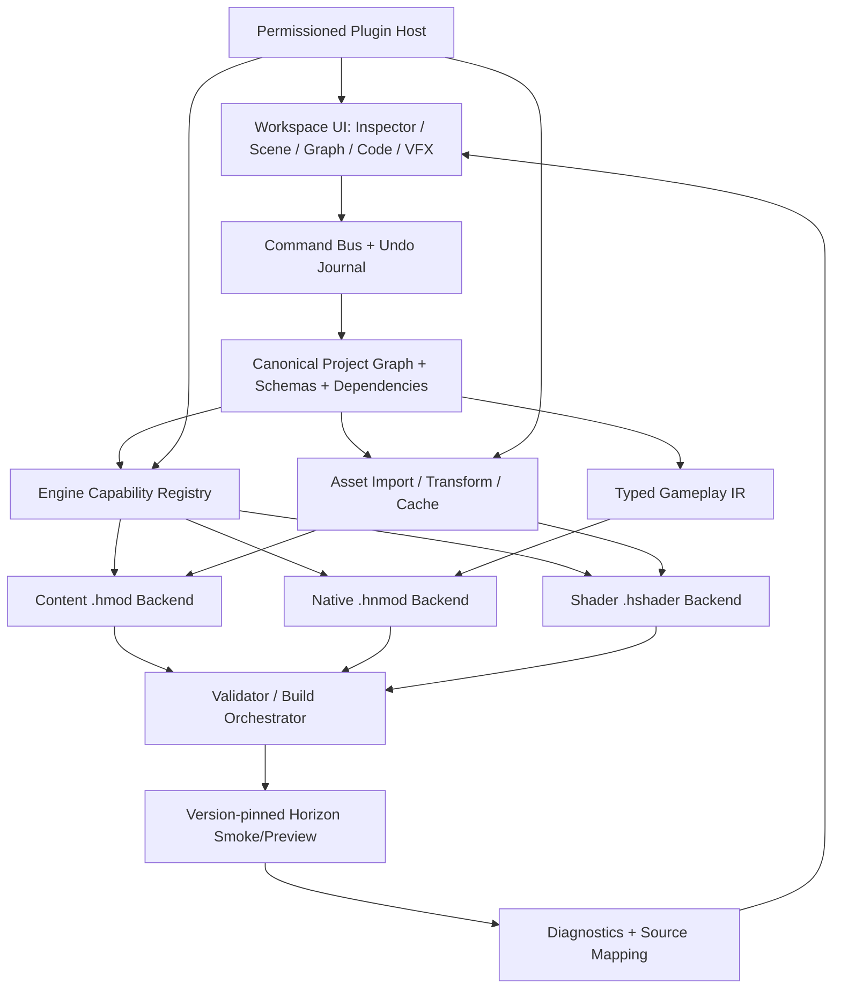
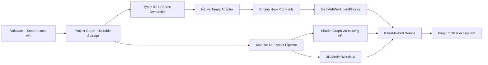

# HORIZON STUDIO — MASTER ENGINEERING ROADMAP & PLATFORM ARCHITECTURE

**Edition:** 2026-10-30 · Research baseline 1.0 · Language: Russian (technical interfaces named in English)  
**Scope:** engineering research, architecture, product strategy, executable backlog. **No repository files were changed.**  
**Evidence class:** **V** = verified by reading repository/source/official API; **CI** = reported successful by GitHub Actions (tests not locally rerun); **I** = engineering inference; **P** = proposal; **U** = not verified in running game.  
**Important restriction:** this report is a read-only static/source audit, **not** an end-to-end runtime or Windows GUI test. A local clone of the repositories and the Horizon game could not be executed in this environment. Benchmark and UX targets below are goals, not empirical results.

## 1. Executive Vision

**Vision:** make Horizon Studio a modular, extensible creative development environment for Horizon, serving **No-Code / Low-Code / Full-Code** users from one project representation and one reproducible build pipeline. The key architectural principle is *capabilities, not promises*: a user can author assets and mechanics independently of whether today's selected engine build already supports them, but Studio must report their actual exportability. No claim of universal game-feature support without working engine hooks.

**Platform kernels (the smallest coherent set of general-purpose systems):**
1. **Versioned Project Graph** — canonical assets, dependencies, identifiers, migrations, and provenance.
2. **Capability Registry + Target Adapters** — content `.hmod`, native `.hnmod`, shader `.hshader`, test/preview and future server integrations.
3. **Typed Gameplay IR + Graph Runtime** — expressions, state, events, components, schedules and determinism; multiple codegen backends.
4. **Asset Pipeline + Scene Representation** — importing textures, models, animation, audio, voxel data, with adapters and provenance.
5. **Authoring/Preview Workbench** — inspectors, commands, property panels, 3D viewport, animation, shader/VFX editing, nodes.
6. **Build/Test/Debug Orchestrator** — cargo, upstream validators, game smoke tests, log capture, deterministic outputs.
7. **Safe Plugin SDK** — dynamically registered editor types, graph nodes, importers, validators and exporters, strongly permissioned.

**Outcome:** combinations of those systems enable diverse content, not thousands of hardcoded forms. Prioritize an end-to-end loop *create → edit → preview → validate → play → diagnose* before adding a second advanced editor.

## 2. Verified Current State — exact baseline

| Repository | Commit SHA (HEAD checked 2026-10-30) | Notes |
|---|---|---|
| Studio | [`63a313f50b08ddccf55e331c99a6e25b7f72d8ad`](https://github.com/pneqnp-iswr/horizon-studio/commit/63a313f50b08ddccf55e331c99a6e25b7f72d8ad) | `master`; version `0.6.0`; release `v0.6.0` published 2026-10-30 13:11 UTC |
| Companion fork | [`186ea2900ca698a61625d691e8f9a63702f99936`](https://github.com/pneqnp-iswr/unlicensed-horizon/commit/186ea2900ca698a61625d691e8f9a63702f99936) | `main`; comparison with upstream: 3 fork commits ahead, 32 upstream commits behind, diverged |
| Upstream engine | [`d2186eb9aa022a64a8b26e6989a04e44fba99ee7`](https://github.com/horizon-rust/horizon/commit/d2186eb9aa022a64a8b26e6989a04e44fba99ee7) | `main`, nightly-driven, Minecraft Java 26.3 |

**Studio repository tree:** 49 entries, nontruncated recursive Git tree. Primary files: `studio.py` (21,954 bytes), `index.html` (58,862 bytes in Git tree), `i18n.js`, `model_viewer.js`, `source_workbench.py`, `source_workbench_ui.js`, `voxel_architect.py`, `mod_doctor.py`, `horizon_cli.py`, `launcher.py`, `scripts/`, `tests/`, `.github/workflows/`, `docs/`, `examples/`. Code was inspected directly, rather than trusting README. License MIT. No requirements manifest/toolchain lock for its Python implementation because it largely uses stdlib; Windows release pins PyInstaller and Pillow in its workflow, though the executable is not signed.

**Source-confirmed core behavior:**

| Feature / subsystem | Finding | Status |
|---|---|---|
| Content blocks/items from vanilla templates | `create_project_files()` writes `horizon-mod.toml`, per-block/item data and game assets, sets `api="0.2"`, `registries`; 32 block + 32 item limits | Implemented but insufficiently tested **in game** |
| Recipes / loot / mining tags | shaped/shapeless data; tags, loot, translations, deterministic ZIP | Implemented but insufficiently tested **in game** |
| Voxel Architect | 6 deterministic procedural NBT structures; rotations/mirror; 12,000-block max, 8 structures | Implemented + unit tested; game placement unverified |
| NBT structure placement | NBT content emitted, no placement system | Incomplete |
| Source Workbench | JSON overrides only for existing generated paths in own mod; size/file quotas; model element validation | Implemented + unit tested; **not** a Rust IDE |
| 3D Viewer | hand-written browser WebGL cuboid mesh with orbit/zoom and 2D fallback | Implemented, interactive functionality unverified with automated browser E2E |
| Resource pack import | fixed allowlist of 18 Minecraft textures from user-supplied ZIP/JAR, local memory, no game assets bundled | Implemented + limited unit test |
| Mod Doctor | deterministic static diagnosis: invalid exports, recipe bootstrap/conflict, RU fallbacks, unplaced structures | Implemented + unit tested; not official validation |
| Local server | `ThreadingHTTPServer` at `127.0.0.1:8787`, 7 POST routes | Implemented + HTTP tests; security hardening needed |
| EN/RU | independent translation catalog and UI toggle; tests check key parity | Implemented + test coverage |
| CLI | `horizon_cli.py` build/export, inspect, doctor; input `.hstudio.json` schema 3 | Implemented + unit tested; no actual game launch |
| Windows EXE | Tk launcher + PyInstaller + CI frozen smoke test | CI success; manual desktop acceptance not checked |
| Official Horizon validator integration | output recommends `cargo horizon-mod check`, never invokes it | **Planned / missing** |
| Native `.hnmod` Rust building | absent | **Planned** |
| Typed graph, AI, VFX, custom dimensions, advanced physics | absent | **Planned / may require engine changes** |
| Fully integrated Rust editing/debugging | absent | **Planned** |

**Tests:** six `tests/test_*.py` files; 69 test methods found in HEAD (`3+26+9+22+7+2`). CI runs Python 3.11/3.12 on Ubuntu and Windows (4 matrix combinations); a release job tests and smoke-tests the frozen EXE on Windows. At checked HEAD, GitHub Actions reported **success** for CI and release. Exact subtest counts at v0.6.0 were not independently established. The old changelog's “59 tests / 105 subtests” refers to v0.5.0, not this HEAD. No browser E2E, official `cargo horizon-mod check`, or real Horizon game-load test found.

**Versioned API reality — essential:**
- Upstream `docs/mods.md` and `crates/horizon-mods/src/content.rs`, `manifest.rs`, `crates/cargo-horizon-mod/src/check.rs` establish content `.hmod` **API 0.2**, with assets/data, `registries`, source/folder validation, and no executable code.
- Upstream `docs/native-mods.md`, `crates/horizon-client/src/game/native_hooks.rs`, `native-hooks.json`, and launcher `native_mods.rs` describe **`.hnmod`** native Rust/horizon-mixins bundles, pinned or stable named hook contracts. The code runs with the player's OS permissions; it is **not sandboxed**. `native_hooks.rs` documents hook API versions through **7** (including block and neighbor changes); `native-hooks.json` is still described as a *draft mapping*, not an unrestricted stable plugin ABI.
- Some historical pages describe Wasmtime/WIT component mods with 0.1/0.3 contracts. Relevant crate structures survive in HEAD, but `docs/api/stability.md` labels WebAssembly mod API levels as **removed**, while the native mod route is the practical priority. Treat WebAssembly as **legacy/conditional**, not the primary architecture. Avoid assuming all pages describe the same runtime status.
- Horizon already implements an **experimental native WGSL shader-pack API**, including `horizon-shader new/check/pack`, `.hshader`, sky/material/post stages, and live file re-check in `crates/horizon-client/src/game/native_shaders.rs`; this may support a first shader graph before new renderer patches.
- Data-pack world generation is partially supported. New dimensions/entities/behavior code must not be promised as content-only mods.
- Minecraft Java JAR mods (Fabric/Forge/NeoForge), GeckoLib runtime code, Java Mixins are **not directly executable** in Horizon.
- The companion `unlicensed-horizon` fork explicitly documents original-content Go/PowerShell tools and *no verified standalone playable alternative*. Studio should use the same Engine Adapter on both upstream and fork; its fork status is a separate compatibility profile. No auth bypass or proprietary asset redistribution.

**Divergence and source-of-truth:** resolve contradictions using (1) code pinned to commit; (2) executable unit/integration tests; (3) current repo docs; (4) public site; (5) older design notes. Every generated compatibility claim must record engine SHA, mod API, validator SHA, platform, date, and evidence artifact.

## 3. Critical Problems in Existing Code

| ID | Severity | Evidence / affected code | Why it matters | Repair / verification |
|---|---|---|---|---|
| C-01 | P0 | `studio.py` `do_POST` lines ~427–459 | POST routes lack explicit `Origin`/`Host`/session-token checks; localhost bind alone is insufficient against all browser cross-origin or DNS-rebinding patterns | enforce loopback/Host allowlist, generated bearer/session token or desktop IPC, Origin/Sec-Fetch-Site policy, JSON content type, automated adversarial HTTP tests |
| C-02 | P0 | `studio.py` `.hmod` archive lines ~370–375 | local schema validation **not** equal to engine/registry acceptance | official version-pinned `cargo horizon-mod check --json` plus real game load fixture |
| C-03 | P1 | `index.html` JS state + browser `localStorage`, `schema:3` | projects saved as a single large browser storage object; no transaction durability or crash-resilient filesystem writes | filesystem workspace + atomic writes + migration/importer; retain legacy import |
| C-04 | P1 | `index.html` ~58 KB one-file UI; numerous global functions | coupling, difficult unit tests, rendering state coupling, fragmented undo | ES modules/types, state store, component registry, command actions |
| C-05 | P1 | `studio.py` limits 32/32/64/8 | unsuitable for large projects; limits may be sensible per starter mod but not one Studio workspace | multiple packages/projects; streaming index, pagination, spec-driven quotas |
| C-06 | P1 | `source_workbench.py` overlays generated JSON only | not a code editor, no Rust source round-trip, generated-file edits vulnerable to re-generation conflicts | ownership boundaries + source map; protected generated outputs |
| C-07 | P1 | `model_viewer.js` WebGL1 cuboid-only | not yet a general 3D modeling or animating tool | import-first, documented format compatibility; add scene graph/viewport in stages |
| C-08 | P1 | `RELEASE_NOTES.md` describes 0.5.0 in v0.6.0 release | release communication is stale and objectively incorrect | generate release notes from version and changelog, release metadata contract test |
| C-09 | P1 | `.github/workflows/tests.yml` Python-only | test pyramid misses real browser, generated `.hmod` compatibility and engine startup | Playwright + official validator + game E2E on controlled runners |
| C-10 | P1 | `horizon_cli.py` JSON project only | CLI/build pipeline does not preserve a multi-mod Cargo workspace or independent source editing | standard workspace tree + `manifest.json` and backend adapters |
| C-11 | P2 | `studio.py` CSP includes `'unsafe-inline'` | expanded third-party/plugin UI would elevate XSS impact | move JS/CSS out, nonce/hashes, tight CSP, plugin isolated origin/process |
| C-12 | P2 | `/api/resourcepack` takes large ZIP | per-file texture limits are present but resource-exhaustion/fuzz cases deserve testing | cap entries, central-directory work, compression ratios, processing time; fuzz ZIP/PNG |
| C-13 | P2 | GUI/theme and fonts in `index.html` CSS | aesthetic and scale/readability lack measurable design system | design tokens, visual QA, user study, tested accessible font choices |
| C-14 | P2 | `docs/FEATURE_MATRIX.md` title still “0.4” | documentation drift | docs generated/linked from capability snapshots |

None of C-01 through C-14 was exploited or empirically measured here: they are source-backed risks, not reports of successful attacks or confirmed runtime defects.

## 4. Competitive Benchmark — 30 UX/engineering criteria

**Evidence base:** official product/manual docs and architecture patterns, not a controlled user study. Legend: **S** strong canonical feature; **P** partial/specialized; **—** not primary product purpose; **?** not established. Product columns represent *archetypes*, not equal-feature products:
- **MC** MCreator + datapack editors, **BB** Blockbench + GeckoLib pipeline, **BL** Blender, **ID** VS Code + IntelliJ/Visual Studio, **GE** Godot + Unity, **UE** Unreal Engine, **RB** Roblox Studio + Figura, **HS** Horizon Studio 0.6.0.

| # | Capability | MC | BB | BL | ID | GE | UE | RB | HS |
|---|---|---|---|---|---|---|---|---|---|
| 01 | Quick non-coder creation | S | S | P | — | P | P | S | P |
| 02 | Minecraft-specific content forms | S | S | P | P | — | — | P | P |
| 03 | Text/code editing | P | P | S | S | S | S | S | P |
| 04 | Rust refactor / LSP | — | — | — | S | — | — | — | — |
| 05 | Reproducible build command | P | P | P | S | S | S | P | P |
| 06 | Node gameplay scripting | S | — | P | — | S | S | S | — |
| 07 | Strong type diagnostics | P | P | P | S | P | S | P | P |
| 08 | Debug/watch/breakpoints | P | P | S | S | S | S | P | — |
| 09 | Scene hierarchy/outliner | P | S | S | P | S | S | S | — |
| 10 | Viewport model selection/gizmos | P | S | S | — | S | S | S | P |
| 11 | UV editing | P | S | S | — | S | S | P | — |
| 12 | Rigging/bones | P | S | S | — | S | S | S | — |
| 13 | Keyframe animation | P | S | S | — | S | S | S | — |
| 14 | Mesh interoperability | P | S | S | P | S | S | P | — |
| 15 | Asset import pipeline | P | S | S | P | S | S | S | P |
| 16 | Shader/material graphs | — | P | S | — | S | S | P | — |
| 17 | Particle/VFX authoring | P | P | S | — | S | S | S | — |
| 18 | Physics scene editing | P | — | S | — | S | S | S | — |
| 19 | AI behavior composition | P | — | — | P | P | S | P | — |
| 20 | World/terrain tooling | P | — | P | — | S | S | S | P |
| 21 | Docking/workspace layouts | P | S | S | S | S | S | S | P |
| 22 | Command palette/navigation | P | P | S | S | S | S | P | — |
| 23 | Undo/Redo transactions | P | S | S | S | S | S | S | P |
| 24 | Plugin extension API | S | S | S | S | S | S | P | — |
| 25 | Source/version control integration | P | P | P | S | S | S | P | — |
| 26 | Multi-user collaboration | — | P | P | S | P | P | S | — |
| 27 | Asset dependency graph | P | P | S | P | S | S | P | — |
| 28 | Accessible learning onboarding | S | S | P | P | P | P | S | P |
| 29 | Security / permissions boundaries | P | P | P | P | P | P | P | P |
| 30 | Horizon `.hmod` target adapter | — | — | — | — | — | — | — | P |

**Interpretation warning:** `S/P/—` expresses broad product orientation inferred from public documentation; it is **not** a quality ranking or tested feature inventory. It groups unlike products, so use this matrix only to identify workflows worth studying, never to assert all members of a column implement the same capability.

**Distinct competitive lessons:**
- **MCreator:** mod-element wizards and understandable visual procedures; avoid locking users into opaque generated code.
- **Blockbench:** compact, texture-conscious 3D workflows, outliner, UV, animation and plugin-defined codecs; **integrate first**, don't duplicate full modeling UX. `.bbmodel` is a versioned internal project format and the vendor recommends dedicated format codecs for reliable exchange.
- **Blender:** mature modeling, UV, compositing, rigging, animation and Geometry Nodes; use it as an external authoring source via glTF/custom converters.
- **VS Code:** discoverability and command palette; **Monaco is not VS Code** and cannot run arbitrary VS Code extensions.
- **IntelliJ IDEA / Visual Studio:** refactoring/navigation/test/toolchain depth; provide integration/open-in-external-IDE rather than replicate every IDE capability.
- **Godot:** scene tree, inspector driven by selection, plugin docks, resource type schemas, small cohesive editor interactions.
- **Unity:** typed components/prefabs, serialized asset metadata and profiling; preserve references and inspector schemas.
- **Unreal:** Blueprint graph validation, executing-wire debug, context menus, gameplay/asset split, VFX/material graph discipline.
- **Roblox Studio:** easy test-in-editor and content sharing; caution around trust boundaries.
- **Figura:** expressive avatar customization and scripting, but its runtime assumptions are not Horizon's.
- **GeckoLib:** animation workflows for Java mod ecosystems; do not promise runtime compatibility without a port.
- **Datapack editors:** fast schema-backed JSON/data editing; preserve transparent file exports.
- **Shader/VFX node editors:** subgraphs, caches, parameters, preview contexts, profile-driven quality.

**Differentiation:** Horizon Studio is **not Blender + Unreal + IDE in one binary**. It is a *Horizon-native content+behavior authoring platform* that makes engine capability and compatibility obvious while reusing mature external DCC and IDE tools.

## 5. Product Philosophy

1. **One project, many workflows** — Beginner settings, Creator nodes, Professional code share identifiers and build graph.
2. **Truthful capability** — unavailable hooks appear as “requires Horizon API extension,” never as silently nonfunctional checkboxes.
3. **Local-first** — no mandatory account or cloud services; explain when original game files/license are required.
4. **Non-destructive edits** — stable IDs, transactional undo, migration backups, lossless source where possible, explicit lossy conversion warnings.
5. **Fast feedback** — preview as soon as possible; distinguish Studio-only preview from real running-game preview.
6. **Import, don't reinvent** — external Blockbench/Blender, rust-analyzer, Cargo, mature render/physics libraries.
7. **Correct boundaries** — no unsafe plugins in the editor core; native `.hnmod` builds only after explicit trust.

## 6. Ultimate Feature Taxonomy

**Authorable object classes:** project/mod/package, asset/material, model/rig/animation, sound, block/item/recipe/loot, entity/prefab/component, behavior graph, event/quest/UI, worldgen/dimension/portal, physics object/vehicle/rocket, VFX/shader/post-process, automation network, testing fixtures, deployment artifacts, plugins. Each object has a globally unique stable ID, named schema version, dependency references and target-capability declarations.

**Subsystem boundaries and engine dependencies:**

| System | Editor deliverable | Engine-side status / gate |
|---|---|---|
| Blocks/items/loot | template editor, component patches, rules, tags | content `.hmod` possible now within verified templates; official checks needed |
| Model/animation | Blockbench/glTF adapters, viewport, rig timeline | arbitrary animated custom entity requires verified model-loader/render hooks |
| Entity/animal/boss | prefab + components + state/AI graphs | requires hooks for spawn, serialization, animation, targeting, combat, server sync |
| AI | BT/GOAP/Utility + pathfinding diagnostic | runtime adapter needed; support simulation mode first |
| Vehicles/rockets | constraints/engines as abstract *game parameters*, sandbox trajectories | needs authoritative entity physics, networking and collision extension; no real weapon engineering |
| VFX | emitter graph → shader/texture/audio/camera; quality levels | WGSL shader pack available experimentally; advanced particles/volumetrics may need renderer APIs |
| Custom dimensions | noise editor, sky, biomes, portal/world presets | full registration/generation/storage/network API not yet verified; prototype preview only |
| Automation/RPG | typed event/logic/component graphs | content-only mods insufficient; native hooks or engine PRs |
| Professional Rust | Cargo workspace editor and diagnostics | `.hnmod` target, pinned hooks, user-trusted build |
| Publication | metadata, signing, hashes, registry submission checks | external registry accepts reviewed submissions; automate package verification, not automatic acceptance |

## 7. Technology Stack Recommendations

| Area | Near-term choice | Future option | Decision rule |
|---|---|---|---|
| Backend | retain Python modules, extract pure contracts into packages | incremental Rust services where CPU/I/O demands justify it | migrate by measured bottleneck, not fashion |
| Desktop shell | existing local web/Tk launcher | **Tauri 2 spike** with Python sidecar, limited IPC | adopt only after equivalent Windows/macOS/Linux test and security parity |
| UI | split current vanilla JS into tested ES/TS modules; design tokens | React/Svelte only if team complexity justifies | preserve onboarding and keep browser testability |
| Rust editor | Monaco + custom JSON-RPC bridge to rust-analyzer | external VS Code/IntelliJ mode | editor is not a VS Code-extension host |
| 3D | evolve WebGL viewer + Blockbench external exchange | choose maintained renderer (e.g. Three.js) after prototype | avoid writing general model renderer/shader engine from scratch |
| Render in game | use Horizon `.hshader` checked WGSL stages | propose narrowly scoped renderer/VFX hooks | every capability proven on pinned engine SHA |
| Gameplay logic | typed IR + simple interpreter for Studio preview | Rust codegen `.hnmod` (restricted supported hooks) | compile to engine-compatible, deterministic output |
| Packaging | reproducible `.hmod`; external official validator | `.hnmod` source bundle, `.hshader` packaging | separate trust and security gates per backend |
| Storage | workspace directories + JSON schema versions + SQLite optional asset index | content-addressed blob cache | no DB as only authoritative format |
| Tests | Python unittest + Playwright + official CLI + game smoke | engine differential fixtures | report separate unit/validation/game statuses |

**No immediate wholesale Python → Rust migration.** A thin Rust/Tauri desktop host can later wrap existing Python validators and an LSP/packager sidecar; a second whole-app rewrite would slow the most important compatibility work.

## 8. Architecture Overview



**Strongly versioned contracts:** `ProjectSchema`, `AssetRef`, `ObjectIR`, `EditorContribution`, `GeneratorContribution`, `TargetProfile`, `CapabilityEvidence`, `BuildJob`, `Diagnostic`, `SourceMap`, `Migration`, `UndoCommand`. All are serializable with explicit version and provenance.

**Illustrative schema (proposal, not implemented):**

```json
{
  "schema": "studio.project/1",
  "id": "example",
  "name": "Example World",
  "targets": [{"engine": "horizon", "revision": "<pinned-SHA>", "mod_api": "0.2"}],
  "packages": [{"id": "example.content", "path": "packages/content"}],
  "assets": [{"id": "urn:studio:asset:lamp", "kind": "block", "source": "assets/lamp.block.json"}],
  "plugins": [],
  "capability_policy": "fail-unsupported"
}
```

**Separation of state:** UI state (selection/layout), project source state (files), derived state (indexes/caches), running-game state (read-only snapshots) must never become one giant mutable JavaScript object. Undo commands operate on project edits, not renderer camera motion.

## 9. Component and Plugin Architecture

**Canonical entity schema:** entity = prefab ID + transform + render/animation + collider + health/attributes + interaction + logic graph references + networking/serialization strategy. This is an **editor-side model** initially; execution is conditional on a target adapter. ECS may be used internally but cannot be assumed to be Horizon's public modding ABI.

**Plugin manifest (proposal):** `studio-plugin.json` with semantic API range, unique ID, declared contributions, permissions `asset.read`, `asset.write`, `project.inspect`, `generator.execute`, `native.build` (the last never silently granted); signed optional, reviewed/known publisher optional. Run untrusted importers/scripts as subprocesses or Web Workers with tight resource quotas; avoid granting native filesystem/process access to remote web plugins.

**Contribution points:** `registerAssetType()`, `registerInspector()`, `registerEditorPanel()`, `registerImporter()`, `registerExporter()`, `registerGraphNode()`, `registerValidator()`, `registerTargetAdapter()`, `registerTemplate()`, `registerPreviewProvider()`. Each uses versioned message schemas and cancellation handles; plugin crashes must not crash the workspace.

**Migration:** store a durable migration log and backup, never silently discard unknown plugin data; absent plugins show opaque placeholders with linked evidence rather than deleting nodes. Enforce round-trip and forward-compatibility tests.

## 10. Rendering, Physics and AI Architecture

### 10.1 Three-dimensional authoring

**Stage 1:** zoom/orbit/pan, grid, scene selection, ray-picking, transform gizmos, editable cuboids, hierarchy, materials; retain WebGL fallback. **Stage 2:** UV atlas, model importing, reusable prefabs, animation/keyframes/timeline, bones, emissive/normal maps, glTF converter, reliable Blockbench export. **Stage 3:** GPU instancing, LOD, selection of thousands of nodes, render graphs and tooling. Don't claim `.bbmodel` directly equivalent to Minecraft Java JSON: conversions can lose custom metadata, armatures and animations.

**3D interchange matrix:** Java block/item JSON → native current content path (restricted, verified by Studio local tests); custom `.bbmodel` → external Blockbench or Studio adapter proposal; glTF → interchange preview and geometry pipeline proposal; OBJ → offline geometry exchange, weak animation semantics; GeckoLib animations → import for editing, but Horizon runtime needs separate implementation; NBT → existing voxel exporter, not a full editable world.

### 10.2 AI and navigation

AI graph has layered controller: perception (`sight/hearing/nearby`), memory/blackboard, decision (FSM / BT / utility / GOAP), action queue, movement/voxel navigation, scheduling, network replication. Define per-agent `budget_us`, tick interval, group LOD, path search node limits and server-authoritative ownership. Prioritize deterministic finite-state/BT authoring; LLM NPCs are **optional noncritical adapters** with timeout, moderation, offline fallback and explicit external-data access permission.

### 10.3 Physics authoring

`Arcade`, `Balanced`, `Simulation` should be parameter presets for **game physics**, not claims of real aerospace fidelity. Authoring components: rigid body, drag, gravity scale, buoyancy approximation, collision shapes, hinge/constraint, energy flow, propulsion, assembly joints, material damage/structural integrity. Physics Sandbox shows velocity/forces/collisions/traces and an explicit approximation banner. Studio-side trajectory simulator first; authoritative runtime adaptation only after capability discovery and network/storage tests. Safety scope: fictional game vehicles/rockets and visual effects, not weapon construction instructions.

### 10.4 VFX

**Typed graph:** `Event → Spawn/EnergyBudget → Emitter → Simulation → Material/WGSL → Lighting → Audio → Camera`. Distinguish *game state* (damage, persistent terrain edits) from *client visual state* (particles, post-processing, camera movement). Provide quality profiles, culling, particle quotas, frame times, CPU/GPU paths, slow-motion replay, seeded determinism. A cinematic mushroom-shaped explosion demo can include bloom, shock-ring, procedural clouds, debris, camera and sound using game-only parameters; server impact must remain independent from visuals. Existing Horizon `.hshader` support is the first adapter; rendering arbitrary GPU particles/volumetrics will likely need additional shader/renderer hooks, to be confirmed by implementation spikes.

## 11. Visual Programming & Code Generation

**Typed Gameplay IR:** a versioned directed graph with typed input/output ports, effects (`Pure`, `ReadWorld`, `ServerMutation`, `RenderOnly`, `UnsafeNative`), event/tick lifecycle, bounded loops, state variables, explicit ownership/client-server authority, timers and cancellation. Validate graph acyclicity where appropriate, event contract availability, type/effect mismatches, recursion limits and resource budgets. Graph nodes contain stable IDs and target capability requirements.

**Code synchronization choice:**

| Model | Cost / strength | Decision |
|---|---|---|
| One-way generated code | simplest and deterministic; manual changes overwritten | initial default for machine-owned output only |
| Full bidirectional source ↔ graphs | notoriously ambiguous Rust patterns, hard to preserve user intent | **do not promise** |
| AST patching arbitrary Rust | parse useful but unreliable on unknown macros/semantics | scoped opt-in transformation only |
| Stable generated sections | workable when only Studio owns regions, diffable | initial native backend |
| Canonical IR + separate user extension modules | stable IDs, clear ownership; manageable compilation boundary | **main strategy** |
| Plugin-specific custom generation | extends backends with tests and capabilities | after core schema stabilizes |

**File ownership boundary:** `generated/` is a build product, `src/user/` is never overwritten, `src/lib.rs` bridge uses imported generated module when contract supports it. Studio does not claim edits inside arbitrary Rust functions round-trip to the graph. `codegen-manifest.json` stores hashes + source spans. When code is manually changed within generated regions, detect drift and offer **adopt as custom code / restore generation / inspect diff**, never silently erase.

**Demonstration chain:** `Entity takes damage` graph node (editor authoring) → `on_damage` IR → target hook lookup → native backend emits Rust wrapper only if that event exists at the pinned Horizon revision → `cargo check` + mod check → provenance and game smoke test. Missing hook yields actionable `ENGINE_CAPABILITY_MISSING`, not an output file that does nothing.

## 12. Horizon Integration Strategy

| Adapter | Compatibility basis | Toolchain | Runtime limitations |
|---|---|---|---|
| Content | `api="0.2"`, `registries`, namespaces/assets/data | official `cargo horizon-mod build/check/run` | static content only |
| Native | `.hnmod` `horizon-mixin.toml` + source, pinned `horizon_revision` or named hooks API | `horizon-native-mods`/`horizon-mixins` tooling and launcher explicit trusted native-build | no sandbox, per-commit build; no arbitrary server-native pipeline yet |
| Shader | `.hshader`, experimental WGSL pack contract | `horizon-shader new/check/pack` | only supported stages and resource limits |
| Legacy Wasm | historical `.hmod` `mod.wasm`, WIT components | feature-gated/transitioning code; independently test before any support | avoid default new-project pathway |
| Fork profile | project-specific fork SHA | same APIs if compatible | 32 upstream commits behind at audit; separate CI matrix |

**Engine request templates (no upstream files changed):**
1. **Entity registration/serialization** — inspect `crates/horizon-client/src/entities.rs`, `src/mobs/`, `game/creatures.rs`, `mobs/ai.rs`, `game/remote_mob_data.rs`. Check whether static data or existing hooks suffice. If not, propose a versioned registry + sync contract upstream; fork patch only for isolated test.
2. **Server events/actions** — inspect `game/native_hooks.rs`, `game/native_lifecycle.rs`, `game/native_world_read.rs`, `native-hooks.json`, `crates/horizon-server/src/engine.rs`. Prefer named hook additions and tests; dedicated-server-native builds require separate support.
3. **Particles / VFX** — inspect `game/level_particles.rs`, `game/postprocess.rs`, `game/native_shaders.rs`, `crates/horizon-shader-api/`, `crates/horizon-client-render/`. Try shader pack contract before proposing renderer extension; test limits and multiplayer visuals.
4. **Dimensions/worldgen** — inspect `crates/horizon-world/`, `game/levels.rs`, `game/nether_portal.rs`, `src/vanillagen/`, `docs/world-generation.md`. Define ID + save format + serialization, portal, network packet, respawn, chunk generation; likely multi-subsystem engine change.
5. **Vehicles/physics** — inspect `game/boats.rs`, `game/minecarts.rs`, `game/lan_vehicles.rs`, `game/machines.rs`, `src/motion/`, and collisions in render/core crates. First define read/authoritative simulation boundary, not source patch by filename guess.

For every engine issue/PR include: `missing API`, `reproduction`, `source code path verified at exact SHA`, `mod-only alternative`, `new public contract`, `compatibility/shim plan`, `security & performance`, `CI tests`, `rollout`. Use experimental fork only when needed, then upstream a narrow API. No automatic engine modifications and no license/auth bypass.

## 13. UX/UI Design System

**Design direction:** clean dark workbench with Minecraft-inspired materials and pixel accents **without copying copyrighted icons or fonts**. Use permissively licensed pixel typeface only after checking OFL/redistribution; readable UI sans-serif for long sessions and code monospaced face. Brand identity must be original. Default English; Russian full parity.

**Layout:** title + quick-switcher; left project/asset explorer with virtualized tree; central tabbed editor (3D/graph/code/textures); right context inspector; bottom console/build/diagnostics; collapse, dock, split/multiple monitor profiles. Build states always visible: `Saved`, `Dirty`, `Validating`, `Build failed`, `Validated`, `Game-tested`, `Unsupported on engine SHA`.

**Core UX transactions:** command palette; searchable object creation; context-sensitive right click; keyboard-first actions; atomic undo/redo; editable property chips; drag-drop import; asset reference picker; reversible graph actions; onboarding with 2-minute tutorial; template gallery; explanatory warnings vs alerts; crash/session restore; explicit visual indication when a preview is Studio-simulated rather than in-game.

**Asset scale:** 10k assets → virtualized explorer, lazy thumbnails, indexed tags, dependency graph, async parsing, cancellable imports; 3D preview 200k triangles or instanced voxel scenes need GPU performance budgets, not guaranteed by current WebGL viewer.

**Privacy:** local-only by default. Never send projects/models to AI servers without explicit consent. Prompt on starting external binaries/native code.

## 14. Security & Asset Licensing

**Threat model:** malicious ZIP/PNG/JSON, untrusted third-party plugins, corrupted project paths, unsafe native `.hnmod` source, browser-to-localhost requests, compiler execution, symlink/archive traversal, remote dependencies, supply-chain binaries, accidental proprietary asset redistribution.

**Controls:**
- Session-bound trusted origin or desktop IPC; validate `Host`, `Origin`, Content-Type, methods and CSRF token; loopback binding is defense-in-depth, not a complete protection.
- Named workspace roots; canonical-path containment, symlink policy, atomic writes, no arbitrary path overrides, archive quotas, fuzz tests.
- Decode image/content with verified limits: dimensions, bytes, count, CPU time, compression ratio, file count; reject malformed payloads.
- Worker/process isolation for plugins; per-plugin workspace permission grants; subprocess resource limits; do not load arbitrary plugin JS in privileged main window.
- Native code executes with user's permissions; explicit red trust prompt, source inspection, pin hashes, isolated game instances, disclose network/file access. Do not label native mods sandboxed.
- No checked-in Mojang assets, Minecraft code or account credentials. User-supplied resource packs remain local; exporting content into redistributable packages requires verifying licenses and source rights. Font/icon licenses recorded in `THIRD_PARTY_NOTICES`.
- CI pin actions and artifacts where practical, dependency review, reproducible packages, SHA-256 checksums, release signing when established, optional SBOM, vulnerability reporting.

## 15. Testing and Release Engineering

**Five-tier quality model:**
1. **Unit/contracts:** 69 existing tests remain; add schema, IR, graph, serializer, ZIP-fuzz, shader checks and migration tests.
2. **Editor integration:** Playwright mouse/keyboard workflows, EN/RU, desktop resize, accessibility scanning, save/restore and 3D visual baselines.
3. **Toolchain compatibility:** pinned `cargo horizon-mod check --json` per fixture; native mixin checker/build on safe authored fixtures; shader checker.
4. **Actual game:** start pinned Horizon client with test content; inspect logs/registry and known item/block; build trusted native template; test shader hot reload; preserve screenshots and JSON evidence.
5. **Release/security:** Windows/macOS/Linux smoke, upgrade/migration, local API attack tests, signing/checksums, rollback.

**Release statuses must distinguish:** `unit-tested`, `official-validator-tested`, `game-load-tested`, `manual-UX-reviewed`; no one badge may stand for all four. CI matrix includes `os × python × engine SHA × mod target`; expensive native/game tests can be nightly and required before stable release. Use a separate instance/world with backups. Store logs, package hashes, screenshots, versions and command transcripts.

**Manual approval gate:** compiling a native `.hnmod` or launching an external binary must be an explicit user action. CI can compile its own trusted test fixture only, not arbitrary contributed code with broad credentials.

## 16. Detailed Phased Roadmap

**Effort units:** **S** 1–3 engineer-weeks; **M** 4–10; **L** 11–24; **XL** >24, with major uncertainty. These are **comparative planning buckets**, not calendar promises; estimates exclude upstream design/acceptance and new-engine research.

| Phase | Objective / major deliverables | Dependencies | Complexity | Gate / demonstrator |
|---|---|---|---|---|
| **F0 — Integrity Foundation** | pin upstream; validator runner; secure API; source docs; release metadata; browser tests | existing code | M | simple `.hmod` passes official validator + real game test |
| **F1 — Durable Workspace** | project graph v1, migration from schema3, filesystem storage, ID refs, undo journal, asset index, plugin contracts | F0 | L | import old project → edit → crash recovery → identical output |
| **F2 — Professional Editor** | modular UI, dock/layout, search, Rust code bridge, rust-analyzer, Cargo diagnostics; 3D selection + Blockbench interchange | F1 | L–XL | edit Rust file, receive diagnostics, model round-trip with declared loss report |
| **F3 — Visual Modding** | typed graph IR, validation, schema-driven inspector, generated ownership, `.hmod` + safe `.hnmod` bridges | F1/F2 + engine hooks | XL | one graph builds native mod only on supported hook contract |
| **F4 — Gameplay Systems** | prefab/entity components, attributes, AI BT, events, blocks/items data patches, RPG/automation | F3 + engine API | XL | smart animal or boss in game with persistence/sync |
| **F5 — Simulation & VFX** | shader graph over `.hshader`, particle authoring, physics sandbox, transport editor, cinematic demo | F2, shader API + missing hooks | XL | visual game effect scales across quality profiles; logical damage independent |
| **F6 — Native Engine Integration** | accepted/pinned capability enhancements: entities, server events, worldgen, physics, rendering | ongoing upstream coordination | XL, external | real engine integration matrix, no undocumented patches |
| **F7 — Platform & Ecosystem** | SDK, plugin marketplace/index, stable docs, templates, collaboration opt-in, signed releases | F0–F6 maturity | XL | third party implements a new type/editor/backend with no core edits |
| **F8 — Advanced Creative Platform** | advanced animation, AI perception, procedural worlds, complex sims, multiplatform authoring, team assets | F7 + market evidence | XL | 8 demos end-to-end, community plug-in proof |

**F0 acceptance:** 0 unmitigated local API criticals, official validator result attached to a generated test `.hmod`, real game load success evidence, clean CI; release notes match tag. **F1:** no data loss in crash/legacy migration tests; undo/redo stable; 1000-object synthetic workspace browsable. **F2:** Rust LSP reliable and cancellable, editing is not limited to generated JSON; Blockbench format conversion explicitly measured for loss. **F3:** source ownership stable, unsupported capability never builds silently; all graph nodes have unit tests. **F4–F6:** per-object authoritative server/runtime protocol and regression suite, real in-game demonstrations. **F7/F8:** independent plugins, migration proof, high-quality documentation, contribution pipeline.

**Parallel opportunities:** (a) UX/design system, (b) shader authoring adapter, (c) Blockbench import/export, (d) docs+tests can run alongside the project graph only after contract freeze; do not run multiple competing schemas. Native and worldgen tracks depend on engine APIs and are **not** blockers for content workflow.

## 17. Dependencies and Critical Path



**True critical path to credible modding product:** official `.hmod` compatibility → durable project graph → typed IR → capability registry → native hooks → real game-test harness → vertical demo. Shader and Blockbench workflows can develop parallel once asset IDs are fixed.

**Team profiles:** one developer + AI: prioritize F0–F2, use existing DCC/LSP, do only one graph/runtime vertical at a time; keep upstream fork maintenance isolated. Small team (3–6): one platform/contracts, one UX/asset viewport, one runtime/CI, with peer reviews. Mature team (10+): bounded tracks for core editor, engine integrations, renderer/VFX, AI/physics, DX/QA, design/community with quarterly contract stability reviews. Do not schedule calendar dates without staffing, hardware and upstream acceptance assumptions.

## 18. Prioritized Engineering Backlog

**Scoring (proposal):** for each ticket rate 0–5 on `U` user impact, `R` reuse/platform unlock, `T` testability, `C` community benefit, `E` engineering effort, `D` engine-dependency risk, `S` security/maintenance burden. Ranking score = `(3U+4R+2T+C) / (1+E+D+S)`. **Override:** P0 security/data loss/compatibility gates always first. Scores are prioritization heuristics, not measured business returns.

| ID | Priority | Work | Unlock / proof | Rough effort |
|---|---|---|---|---|
| HS-001 | P0 | official `.hmod` validator runner with pinned SHA | trustworthy export gate | S |
| HS-002 | P0 | real game smoke + log evidence | first verified in-game content mod | M |
| HS-003 | P0 | local API threat hardening | safe expansion to file/compile actions | S–M |
| HS-004 | P0 | fix release-notes version drift, docs status | reliable publication metadata | S |
| HS-005 | P1 | schema3 migration into project graph v1 | all future object types | M–L |
| HS-006 | P1 | atomic workspace save + undo | durability and UX | M |
| HS-007 | P1 | split monolithic HTML/JS, Playwright suite | maintainable UI | M |
| HS-008 | P1 | capability registry per engine SHA | avoids unsupported promises | M |
| HS-009 | P1 | Blockbench conversion adapter + loss reports | 3D content leverage | M |
| HS-010 | P1 | native `.hnmod` template check and trusted build | logic beyond content | L |
| HS-011 | P1 | Monaco + rust-analyzer + Cargo adapter | genuine pro mode | M–L |
| HS-012 | P1 | IR v1 + one event graph backend | graph platform | L |
| HS-013 | P1 | `.hshader` checker and shader graph v1 | high-value VFX early | M–L |
| HS-014 | P2 | AI/BT authoring with simulation + budgets | smart entities | L |
| HS-015 | P2 | physics sandbox with debug overlay | vehicles/rockets | XL |
| HS-016 | P2 | dimension/noise generator editor | custom worlds | XL, engine-dependent |
| HS-017 | P2 | secure plugin host SDK | independent new editors | XL |
| HS-018 | P2 | community marketplace/publishing | ecosystem | XL |

**Risk ledger:** upstream hook churn (high); scope explosion (high); untrusted native execution (critical trust); model conversion loss (medium); custom world serialization (high); server synchronization (high); GPU effects performance (high); AI nondeterminism (medium/high). Maintain fallback and cancellation for each expensive path.

## 19. Eight End-to-End Demo Projects

Each demo is a **contract probe**. “Current” refers strictly to Studio source at pinned HEAD, not validated in running game.

| Demo | User creates / Studio tools | Possible now | Missing APIs/work | Automated success proof |
|---|---|---|---|---|
| **A Smart Animal** | original model+UV, skeleton, animation, health, perception, BT | static assets/model JSON only | spawn/AI/animation/network/serialization native hooks | spawn in controlled world, behavior reproducibility, reload persistence, FPS guardrail |
| **B Intelligent Boss** | boss phases, patterns, VFX, attacks, AI state, health bar | static item/block themes | server events, boss combat, animations, HUD effects | phase transition recorded under synthetic combat, deterministic log |
| **C Rocket Simulation** | fictional assembly, thrusters, game energy, trajectory, flight controls | local simulated graph if built; not in current Studio | game rigid body/vehicle/control/network hooks | scripted launch reaches specified *game* checkpoint; energy balance within tested tolerance |
| **D Cinematic Explosion** | giant fantasy explosion, cloud, shockwave, audio, camera, terrain-rule graph | ordinary content assets; shader API exists upstream | shader graph adapter, particles, visual/runtime separation, terrain editing contract | seeded visual playback; gameplay damage invariant across Low/Ultra |
| **E Custom Dimension** | sky, biome, terrain noise, portals, gravity and creatures | limited NBT structure generation only | custom dimension worldgen registration, save/network/portal APIs | same seed same terrain hash; transition+save/reload world |
| **F Automation** | machines, conveyor networks, energy, block state & GUI | static blocks/items/recipes | native simulation, tick/block events and persistence | constructed circuit produces scheduled output with bounded tick work |
| **G RPG System** | classes, abilities, quests, reputation, NPCs, progression | basic items/recipes only | attributes, events, server storage, GUI, dialogue | quest state survives save/reconnect; no unauthorized progression edits |
| **H Complete Rust Mod** | visual template, custom Rust source, build/run/debug | local JSON text overrides & `.hmod` export | Cargo/LSP, `.hnmod` integration, native build, debugger, game launch | clean cargo diagnostics, trusted native checker, game hook observed |

**Demo priority:** H (native proof), A (entity platform), D (shader/VFX differentiation), F (events/state), B (AI composition), G (systems/integration), E (worldgen), C (physics). This is **dependency-informed order**, not customer popularity.

## 20. Performance and Quality Targets — proposals, NOT measurements

| Metric | Target for dedicated benchmark | Method |
|---|---|---|
| Time to first working **in-game** block mod | median < 8 min for first-time user after engine installed | 10+ novice sessions, timed with event markers |
| Reopen 1,000-object workspace | p95 < 3 s on agreed baseline hardware | cold start repeated × 30; cache separately |
| Search 10,000 assets | p95 interaction < 100 ms | synthetic asset corpus and tracing |
| Common inspector actions | p95 < 100 ms UI commit | browser Performance timeline |
| Viewport movement | p95 <= 16.7 ms on target GPU for baseline scene | frame-time capture, three GPU tiers |
| Incremental `.hmod` build after one asset | p95 < 3 s excluding first toolchain setup | 50 repeated edits, warm vs cold stated |
| Project save durability | zero lost confirmed writes in 100 fault-injection trials | kill process during atomic save/recovery |
| Native build | report benchmark only; no ungrounded target | measure per SHA/hardware/Cargo cache |
| Mod game-load validation | 100% on supported fixture matrix | real client run + log/behavior assert |
| Accessibility | keyboard reachability + WCAG 2.2 AA for core controls (goal) | automated scans and manual screen-reader |
| Memory use | establish baseline then budget, no invented MB figure | 1k/10k assets, image stress, GPU leak profiling |
| AI tick cost | configurable per-agent/server quotas, measured | 100/1k/10k NPC synthetic worlds with controlled CPU |

Test profiles: minimum laptop/standard desktop/high-end GPU; Windows 11, Ubuntu, macOS; GPU vendors; browser/WebView engines. Every performance claim must preserve scene version, test SHA, driver, hardware, percentiles and trace.

## 21. Risks and Alternative Strategies

- **Monolithic platform:** counter with 7 small interfaces, contracts, plugin boundaries, multiple independently deployable packages; reject feature-specific core rewrites.
- **Custom 3D renderer too soon:** integrate Blockbench and maintained viewer first; delay bespoke animation graph until requirements justify.
- **Tauri migration trap:** benchmark shell and IPC first; retain Python while proven; do not migrate UI and data model simultaneously.
- **Graph logic unmaintainable:** IR/effect typing, modular subgraphs, replace graph segment with user-owned Rust modules; robust source mappings.
- **Upstream drift:** engine SHA pinned per project, compatibility database, validator CI, no blind nightly upgrades.
- **Unsafe plugins:** no arbitrary in-process trusted extension by default; separate process and granular permissions.
- **Full simulation scope:** use sandbox simulation first, engine hook proof second, quality profiling third; do not pretend simulation equals vanilla parity.
- **Marketplace too soon:** postpone until correct packaging, trust, version constraints, moderation and rollback.
- **Overloaded UX:** progressive disclosure (Beginner / Creator / Professional) over one common project, searchable commands, adaptive panels, task-based navigation.
- **Licensing:** custom icons/assets + optional user supplied packs; provenance index in builds.

**Counterfactual architecture review:** if native hook access remains too narrow for entities/dimensions after several upstream releases, prioritize *best-in-class content/shader IDE* and keep advanced entity/physics authoring as engine-independent experimental work rather than promising game deployment. This does not invalidate the project graph or plugin SDK investment.

## 22. First Three Concrete Development Iterations — directly actionable

### Iteration I — Verified Mod Compatibility & Security (P0)

**Existing files:** `studio.py`, `horizon_cli.py`, `mod_doctor.py`, `tests/test_studio.py`, `tests/test_voxel_http.py`, `.github/workflows/tests.yml`, `.github/workflows/windows-release.yml`, `RELEASE_NOTES.md`, `CHANGELOG.md`, `docs/FEATURE_MATRIX.md`, `README.md`.

**New modules:** `horizon_compat/engine_profile.py`, `horizon_compat/official_validator.py`, `horizon_compat/game_smoke.py`, `security/request_policy.py`, `tests/test_official_validator.py`, `tests/test_api_security.py`, `tests/fixtures/official_ruby/`, `docs/COMPATIBILITY_EVIDENCE.md`, `scripts/check_release_metadata.py`.

**Interfaces:**
```python
@dataclass(frozen=True)
class EngineProfile:
    upstream_sha: str
    game_version: str
    content_api: str
    validator_revision: str

@dataclass(frozen=True)
class VerificationResult:
    stage: str  # local | official | game
    passed: bool
    command: list[str]
    tool_sha: str
    stdout_path: str | None
    stderr_path: str | None
```

**Tasks:** pin engine and official tools; generate fixture and invoke `cargo horizon-mod check --json` in controlled CI; capture SHA, stdout/stderr and package hash; add game smoke fixture where runners have legally prepared game assets; reject hostile Host/Origin and missing session token; remove cross-origin permissive assumptions; check releases use current `VERSION`; update docs. **Do not** add arbitrary filesystem POST endpoints, Rust code execution, Tauri migration, or new entity GUI yet.

**Tests:** origin/host/header fuzz, CSRF from simulated hostile page, schema reject cases, fake official-checker process failure/timeout, actual official checker on fixture, shader-independent regression, release note version verification, no proprietary fixture assets. **Done:** one canonical generated block demonstrably accepted by official checker and loaded in real game with evidence; security tests pass; report honest tier if game unavailable.

### Iteration II — Project Graph, Durability, Modular UI (P1)

**Existing files:** `index.html`, `i18n.js`, `source_workbench_ui.js`, `model_viewer.js`, `studio.py`, `horizon_cli.py`, `source_workbench.py`, `tests/test_source_workbench.py`, `tests/test_launcher.py`.

**New modules:** `studio_core/project_schema.py`, `studio_core/graph.py`, `studio_core/assets.py`, `studio_core/migrate.py`, `studio_core/commands.py`, `studio_core/workspace_store.py`, `web/src/state/`, `web/src/ui/`, `web/src/commands/`, `web/tests/`, `tests/test_project_migration.py`, `tests/test_workspace_recovery.py`.

**Interfaces:** `ProjectStore.open/commit/rollback`, `Migration.upgrade(schema, data)`, `Command.apply/revert`, `AssetGraph.dependencies`, `FileOwner.generated/user`. Preserve `.hstudio.json` schema3 migration from existing examples. Add transaction journal, autosave+atomic rename, backups, source-reference invariants, undo/redo; split frontend without design overhaul; Playwright smoke runs save/import/search/EN-RU. **Do not** add browser-origin native compilers or rewrite all Python into Rust.

**Tests/DoD:** 100 simulated interruptions around save; migration golden files for all 3 examples; undo/redo property-based roundtrip; identical `.hmod` output for untouched imported project; 1,000-object workspace benchmark captured; browser workflows pass on Windows/Linux.

### Iteration III — Capability Registry & First Native/Shader Vertical (P1)

**Existing files:** `horizon_cli.py`, `studio.py`, `model_viewer.js`, `source_workbench_ui.js`, `tests/test_workshop.py`, `.github/workflows/tests.yml`.

**New modules:** `targets/capability_registry.py`, `targets/hmod.py`, `targets/hnmod.py`, `targets/hshader.py`, `ir/core.py`, `ir/typecheck.py`, `ir/codegen/rust_native.py`, `build/orchestrator.py`, `build/diagnostics.py`, `assets/blockbench_adapter.py`, `web/src/graph/`, `tests/test_target_gating.py`, `tests/test_codegen_golden.py`, `tests/test_shader_pack.py`, `docs/ADR/`.

**Interfaces:** `TargetAdapter.detect(profile)`, `TargetAdapter.validate(project)`, `TargetAdapter.build(project, approved_trust)`, `CapabilityRequirement(version, evidence)`, `GraphIR.compile(target)`, `BuildArtifact(hash, sourceMap, logs)`. Build shader material/post example using existing official `.hshader` compiler; separately generate a *trusted example* native hook mod with pinned target and explicit approval. Add model interchange proof with loss report. **Do not** implement full ECS, dynamic dimensions, massive VFX renderer, or a public plugin marketplace.

**Tests/DoD:** stable graph AST IDs; type failures generate precise diagnostic ranges; no unsupported hook builds; source ownership resists regeneration drift; pinned shader checker succeeds; optional native smoke executes example hook on validated pinned build; untrusted code never starts without confirmation.

**P0 / P1 / P2 summary:** iteration I all P0; iteration II all P1 with P0 data-loss regressions; iteration III P1 core targets, P2 optional Blockbench UX refinements. Each iteration ends with reproducible command outputs and user-visible demo, not a slide mockup.

## 23. Long-Term Extensibility Strategy + ADR Register

**ADR-001: Canonical Project Graph** — Context: browser state and schema3 cannot scale. Alternatives: one JSON blob / filesystem schemas / DB-only. Decision: versioned files + stable IDs + derived index; revise if multiuser live edits truly demand shared transactional DB. Pros: inspectable/git-friendly; cons: migrations and references.

**ADR-002: Source ownership and IR** — Context: visual tools vs hand-written Rust. Alternatives: full round-trip, one-way codegen, generated regions + user modules. Decision: typed IR + explicit user-owned modules; revisit for a limited supported Rust AST subset. Pros: deterministic; cons: some graph edits unavailable after arbitrary source changes.

**ADR-003: Target adapters** — Context: .hmod content vs .hnmod native vs .hshader. Decision: independent capability-gated backends with engine SHA proofs; revisit only if upstream publishes unified stable SDK. Pros: resilience; cons: duplicate test matrices.

**ADR-004: Python retention** — Context: initial Python server works and has tests. Alternatives: all-Rust rewrite, Electron, Qt, Tauri sidecar. Decision: retain Python business logic, modularize UI, spike Tauri later. Pros: delivery speed; cons: packaging/process complexity. Revisit after performance/security benchmarks show material benefit.

**ADR-005: Blockbench integration-first** — Context: costly custom DCC. Decision: exchange codecs and external app workflow first; a restricted in-app voxel editor only where round-trip is lossless. Pros: mature tooling; cons: two applications and version compatibility. Revisit based on user metrics.

**ADR-006: Native trust** — Context: .hnmod compiles Rust into executable Horizon. Decision: explicit user trust + isolated instance + pinned source, no auto-build of untrusted imports. Pros: lower security surprise; cons: friction. Review when upstream supplies a true sandbox.

**ADR-007: Shader-first VFX** — Context: WGSL `.hshader` exists today. Decision: implement shader graph adapter first, build custom GPU particle APIs only after measured use case. Pros: fast value and reuse; cons: shader-stage limitations. Review when Horizon stabilizes renderer plugin interfaces.

**API lifecycle:** `experimental` → `preview` → `stable`; explicit deprecation at project schema and plugin API level, migration procedures, compatibility test fixtures, two-line support matrix, additive capability detection. Every third-party extension must be able to register an independent new asset kind and inspector without editing the Studio core; test this with a plugin developed outside the main repository.

## 24. Final Technical Assessment

**Current Studio state (0–10, provisional expert source-based judgment, not a UX/benchmark study):**

| Category | Score | Rationale |
|---|---:|---|
| Architecture | 4 | small but highly coupled Python/HTML global state |
| UI/UX | 4 | clear starter workflow, not yet extensible professional workspace |
| 3D Editing | 2 | 3D viewer exists, no true asset modeling/rigging |
| Visual Programming | 0 | no graph/typed IR |
| Native Rust Integration | 0 | no `.hnmod` builder/LSP |
| Game Compatibility | 2 | valid-looking content emitter, no official/game check |
| Modding Capabilities | 3 | blocks/items/recipes/structures; capped templates |
| Extensibility | 2 | no plugin SDK |
| Build System | 4 | deterministic `.hmod` ZIP, CLI, portable release; lacks target validation |
| Testing | 5 | 69 test methods and 4 CI combinations, major integration gap |
| Reliability | 4 | deterministic local code; durability/security hardening required |
| Community Readiness | 4 | MIT/docs/releases, early alpha, stale notes and missing contribution proof |

**Proposed roadmap quality (0–10; self-evaluation, subject to external review):**

| Category | Score | What must be validated |
|---|---:|---|
| Technical feasibility | 7 | native hook extension design and shader capability tests |
| Architectural coherence | 8 | proof by one content + one native + one shader adapter |
| Extensibility | 8 | actual external plugin exercise |
| User experience | 8 | real user studies and accessibility acceptance |
| Engineering precision | 8 | additional exact APIs/schemas after proof-of-concept |
| Risk management | 9 | explicit incompatibility, trust, security and fallback gates |
| Incremental deliverability | 8 | small iterations and parallel independent tracks |
| Competitive differentiation | 7 | Minecraft/Horizon niche real users needed |
| Research confidence | 7 | code/docs GitHub verified; no full runtime tests |
| Long-term sustainability | 8 | upstream sync budget and community contributors still unknown |

**Recommended next action:** execute **Iteration I**, starting with **HS-001 official `.hmod` validation** and **HS-003 local API security**; only then build a richer shell. This yields a tool users can trust before more impressive but unproven authoring interfaces accumulate.

---

## Primary evidence & research links

**Repositories pinned:**
- Studio SHA: https://github.com/pneqnp-iswr/horizon-studio/tree/63a313f50b08ddccf55e331c99a6e25b7f72d8ad ; primary `studio.py`, `source_workbench.py`, `model_viewer.js`, `.github/workflows`, `tests` inspected.
- Companion fork SHA: https://github.com/pneqnp-iswr/unlicensed-horizon/tree/186ea2900ca698a61625d691e8f9a63702f99936 ; `FORK_DIFFERENCES.md` inspected.
- Upstream SHA: https://github.com/horizon-rust/horizon/tree/d2186eb9aa022a64a8b26e6989a04e44fba99ee7 ; code `docs/mods.md`, `docs/native-mods.md`, `native-hooks.json`, `crates/horizon-client/src/game/native_hooks.rs`, `native_shaders.rs`, `crates/horizon-mods/src/{manifest,content}.rs`, `crates/horizon-client/src/mod_content.rs`, `crates/cargo-horizon-mod/src/check.rs`, `docs/shaders.md` inspected.
- Official content docs: https://playhorizon.dev/docs/content-mods
- Official mod guide: https://playhorizon.dev/docs/mods ; https://playhorizon.dev/docs/make-a-mod
- Official publication: https://playhorizon.dev/docs/publish-a-mod
- Official source lifecycle: https://github.com/horizon-rust/horizon/blob/main/docs/api/stability.md
- Official shader docs: https://github.com/horizon-rust/horizon/blob/main/docs/shaders.md
- Official Blockbench `.bbmodel`: https://blockbench.net/wiki/docs/bbmodel/
- Blockbench formats/plugin APIs: https://blockbench.net/wiki/blockbench/formats/ ; https://blockbench.net/wiki/docs/plugin/
- Godot inspector/plugins: https://docs.godotengine.org/en/stable/tutorials/editor/inspector_dock.html ; https://docs.godotengine.org/en/stable/tutorials/plugins/editor/making_plugins.html
- Unreal Blueprint debugger: https://dev.epicgames.com/documentation/unreal-engine/blueprint-debugging-example-in-unreal-engine
- Rust analysis: https://rust-analyzer.github.io/book/ ; Cargo: https://doc.rust-lang.org/cargo/reference/external-tools.html
- Monaco limitations: https://github.com/microsoft/monaco-editor/blob/main/README.md
- Tauri sidecars / permissions: https://tauri.app/develop/sidecar/ ; https://v2.tauri.app/plugin/file-system/

**Evidence gaps / required follow-up verification:** exact engine SHA of each relevant nightly release, an actual `cargo horizon-mod check` run on Studio's output, full in-game smoke scenarios on licensed/legally prepared resources, Windows UI visual and accessibility tests, engine/native server capability integration tests, upstream issues/PR architecture decisions on custom entities/dimensions, independent plugin API research, controlled comparison UX studies and benchmark hardware measurements. Those are not silently assumed completed.
